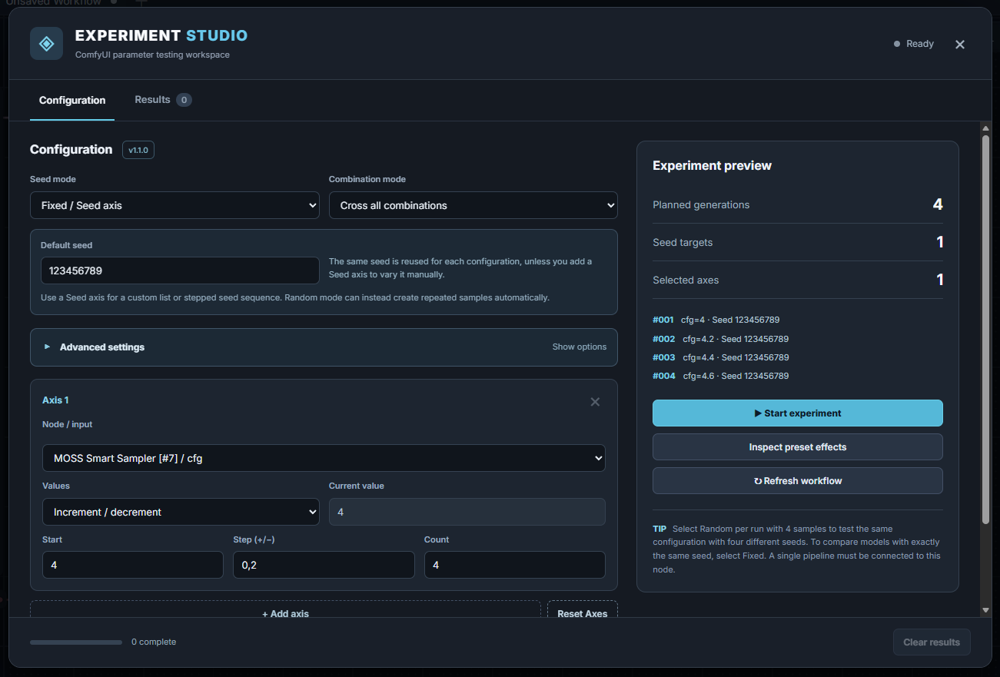

# ComfyUI Experiment Studio
**Test parameters in your existing Workflow, export the result.**

Experiment Studio tests parameters in **your existing Workflow**; it does not require a special sampler graph. Connect the decoded `IMAGE` to **Experiment Studio** and click **Open Experiment Studio**.

# Why use it?
- Sweep model/UNET filenames, LoRA strengths, `sampler_name`, `scheduler`, CFG, steps, denoise, or other directly editable parameters.
- Use up to **12 axes** (and 96 runs), either **Cross all** or **Pair by position**.
- **Nested Axes** keep model-specific LoRAs/presets together: one UNET can run without a LoRA while another uses an eight-step LoRA, without wrong cross-combinations.
- Use fixed seeds, explicit seed values, or unique random seeds per run with configurable repetitions.
- See sampler previews, execution progress, and ETA; browse all images with arrows and **Return to Live**.
- Export caption-wrapped PNG comparison grids, JSON, CSV and full-resolution PNGs.
- Experimental **Inspect preset effects** captures synchronous frontend preset callbacks (for steps, CFG etc.) when supported by the custom node.

# XY Plot comparison
For a conventional **XY Plot**, choose `sampler_name` as Axis 1 and `scheduler` as Axis 2, enter the alternatives and use **Cross all**. With two samplers and three schedulers, you get six tested combinations. You can also add more axes, nest values under specific models, and repeat each configuration with several seeds.

**Export layout:** current PNG output is a **labeled result gallery**, not a strict X-columns/Y-rows matrix.

# Notes
- One working model pipeline at a time.
- Only exposed, unlinked prompt widget inputs can be changed directly. Connected seed inputs are not overridden by the seed controls.
- Preset syncing depends on frontend callbacks; verify with **Inspect preset effects** before submitting large tests.
- Intermediate previews require ComfyUI to send frames. Normal/Reduced controls only the Studio display frequency.
- Pause/Stop apply after the current run; experiments are not resumed automatically after browser restart.

# Sources
- [Custom Node Types and Architecture](https://docs.comfy.org/custom-nodes/overview) — Overview of custom nodes and the ComfyUI client/server architecture.
- [JavaScript Extensions](https://docs.comfy.org/custom-nodes/js/javascript_overview) — Frontend extension registration, UI integration, and custom interfaces.
- [JavaScript Hooks](https://docs.comfy.org/custom-nodes/js/javascript_hooks) — Node lifecycle hooks and interaction with frontend widgets.
- [Server Routes (HTTP and WebSocket API)](https://docs.comfy.org/development/comfyui-server/comms_routes) — Workflow submission, execution queues, history, and server communication.
- [ComfyUI — Server Implementation](https://github.com/Comfy-Org/ComfyUI/blob/master/server.py) — API routes, execution events, queue management, and model unloading.
- [ComfyUI — Progress System](https://github.com/Comfy-Org/ComfyUI/blob/master/comfy_execution/progress.py) — Progress tracking and intermediate preview events.
- [ComfyUI Frontend — Extension Development](https://github.com/Comfy-Org/ComfyUI_frontend/blob/main/docs/extensions/development.md) — Frontend extension conventions and integration guidance.
- [XY Plot Pixaroma](https://workflows.pixaroma.com/help/nodes/xy-plot/) — Reference for XY Plot-style parameter sweeps and labeled image comparisons.
- [ComfyUI Pixaroma — Source Repository](https://github.com/pixaroma/ComfyUI-Pixaroma) — Open-source collection of nodes, including an XY Plot tool.

Thanks to the ComfyUI team and open-source community for the documentation, APIs, and extensibility that make tools like Experiment Studio possible.

Experiment Studio uses ComfyUI's execution infrastructure to provide experiment orchestration, nested parameter combinations, live progress monitoring, and comparative image exports.

# License
See [LICENSE](LICENSE).