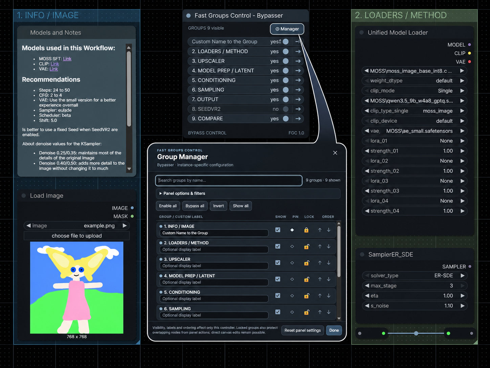

# ComfyUI Fast Groups Control
**A custom Fast Groups Control for Bypasser and Muter.**

Fast Groups Control is a compact visual dashboard for managing ComfyUI groups. It introduces two frontend-only virtual nodes with a shared **Group Manager**, letting you decide which groups are shown, arrange them in a custom order, create short display labels, and protect groups against accidental panel actions — all without affecting the underlying Workflow configuration when simply hiding a group.

## Nodes
| Node | When disabled | When enabled |
| --- | --- | --- |
| **Fast Groups Control - Bypasser** | Set member nodes to **Bypass** (`mode = 4`) | Set member nodes to **Always** (`mode = 0`) |
| **Fast Groups Control - Muter** | Set member nodes to **Mute/Never** (`mode = 2`) | Set member nodes to **Always** (`mode = 0`) |

Both are virtual frontend nodes with **no connection ports** and no execution cost in a generation queue.

## Features
- **Group Manager:** click **Manage** in the node header or select **Manage Groups...** from its context menu.
- **Independent visibility:** hide groups from the controller list without bypassing, muting, deleting, or changing their actual nodes.
- **Manual ordering:** drag and drop or use the up/down controls; optional canvas-position, alphanumeric, and custom-prefix sorting.
- **Pin Groups:** keep frequently used groups at the top of the list.
- **Custom Labels:** abbreviate displayed names without renaming ComfyUI groups.
- **Group Lock:** prevent mode changes from this panel, also protecting shared nodes belonging to a locked overlapping group in the same controller.
- **Mixed-state detection:** identify groups that contain a mixture of active and inactive nodes.
- **Bulk Actions:** Enable All, Bypass/Mute All, and Invert for shown, unlocked groups only. Conflicting overlapping inversion requests prioritize enable.
- **Filters:** group-name text/regex filters and color filters, independent of visibility preferences.
- **Navigation:** optional arrow to focus a group in the current canvas.
- **Nested subgraphs:** optional discovery across nested graphs; open a subgraph to navigate to its groups.
- **Compact layout:** adjust row density for large Workflows.
- **Instance-local preferences:** Bypasser and Muter each keep their own visibility, order, aliases, filters, locks, and layout.
- **Manual resize persistence:** retain user-defined panel dimensions after reloads.
- **Workflow persistence:** options are serialized into the controller's `properties.fgc`; the actual node modes remain controlled and serialized by ComfyUI.

## Usage notes
**Hiding is not disabling.** Disabling a row's **Show** checkbox hides that row from the controller dashboard; it does not change any node mode.

**Lock applies to this controller only.** It will not prevent edits made directly in ComfyUI or by other controller instances.

**Overlapping groups share real nodes.** A member can be affected by more than one group. The controller reads LiteGraph node modes rather than storing a separate, potentially misleading on/off state.

**Loading a Workflow is non-destructive.** The dashboard never resets group modes during Workflow load, even when the layout and saved visibility settings are restored.

**Group identity.** Native group IDs are used when available. Otherwise title and approximate position are used, so a simultaneous large movement and rename of an ID-less group may require reselecting preferences for that row.

**No rgthree dependency.** This is an independently implemented module. The UI concept is inspired by rgthree's Fast Groups tools, but the plugin does not import or bundle rgthree code.

## Credits
**Special thanks to [@rgthree](https://github.com/rgthree)**, creator of [rgthree-comfy](https://github.com/rgthree/rgthree-comfy) and the original Fast Groups Muter / Fast Groups Bypasser. Their thoughtful UX design popularized this convenient way of controlling ComfyUI groups and inspired this independent implementation.

## Sources
- [ComfyUI official documentation — JavaScript Extensions](https://docs.comfy.org/custom-nodes/js/javascript_overview) — how `WEB_DIRECTORY` and `app.registerExtension()` load frontend modules.
- [ComfyUI official documentation — JavaScript Hooks](https://docs.comfy.org/custom-nodes/js/javascript_hooks) — extension registration, `registerCustomNodes`, and graph lifecycle hooks.
- [ComfyUI frontend — Extension architecture](https://github.com/Comfy-Org/ComfyUI_frontend/blob/main/docs/extensions/core.md) — frontend extension conventions and compatibility practices.
- [ComfyUI frontend — `LGraphGroup`](https://github.com/Comfy-Org/ComfyUI_frontend/blob/main/src/lib/litegraph/src/LGraphGroup.ts) — group membership, identity, geometry, and recomputation mechanisms.
- [ComfyUI frontend — `PrimitiveNode` (`widgetInputs.ts`)](https://github.com/Comfy-Org/ComfyUI_frontend/blob/main/src/extensions/core/widgetInputs.ts) — example of assigning the category after registering a frontend-only node.
- [ComfyUI frontend — `LGraphCanvas`](https://github.com/Comfy-Org/ComfyUI_frontend/blob/main/src/lib/litegraph/src/LGraphCanvas.ts) — category menus and custom node interaction behavior.
- [VicNodes — main module loader](https://github.com/VictorDmAlves/comfyui-vicnodes/blob/main/__init__.py) — discovery and logging for Python modules and their registered nodes.
- [rgthree-comfy — Fast Groups Muter](https://github.com/rgthree/rgthree-comfy/blob/main/src_web/comfyui/fast_groups_muter.ts) — original group-control UX and filtering reference (credit and conceptual inspiration only).
- [rgthree-comfy — Fast Groups Bypasser](https://github.com/rgthree/rgthree-comfy/blob/main/src_web/comfyui/fast_groups_bypasser.ts) — original bypass behavior reference (credit and conceptual inspiration only).

## License
See [LICENSE](LICENSE).