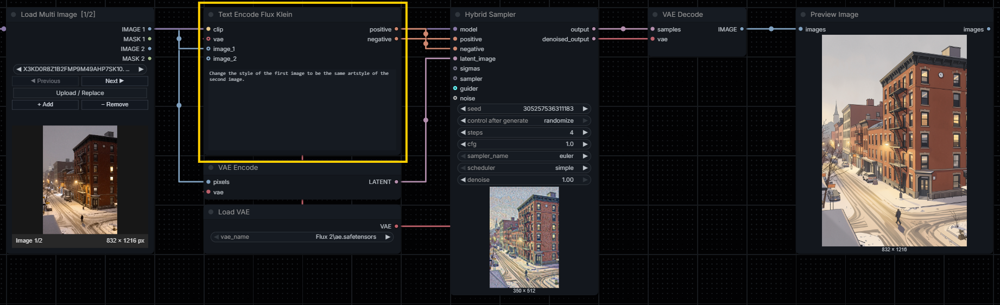

<div align="center">

# ComfyUI Flux Klein Text Encode
**Simple and functional Text Encode for Klein.**


</div>

A compact **FLUX.2 Klein** text encoder with dynamically growing multi-image reference inputs; no more needing to attach `Reference Latent` for every single image.

This, combined with my [Load Multi Image](https://github.com/VictorDmAlves/comfyui-load-multi-image) `custom_node`, you will have a more streamlined and clean Workflow for your image generation, using both Flux Klein 4B and 9B.

## Latest release
### 1.0
Added
- Initial commit

# Installation

### Git
Open a terminal inside the ComfyUI `custom_nodes` directory and clone the repository:

```bash
cd ComfyUI/custom_nodes
git clone https://github.com/VictorDmAlves/comfyui-flux-klein-text-encode.git
```

### ZIP
1. Download the repository as a ZIP file.
2. Extract it into `ComfyUI/custom_nodes/`.
3. Make sure the final structure is not nested twice.

Restart ComfyUI and add **Text Encode Flux Klein** from `extensions/VicNodes/Flux Klein Text Encode`.

## Node
| Input | Type | Description |
| --- | --- | --- |
| `clip` | `CLIP` | FLUX.2 Klein text encoder |
| `prompt` | `STRING` | Positive prompt (multiline) |
| `vae` | `VAE`, optional | Required only when image references are connected |
| `image_1` ... `image_4` | `IMAGE`, optional | Autogrowing image sockets (default maximum: 4) |

**Outputs:** `positive` and `negative` (`CONDITIONING`). There is **no negative prompt field**, latent output, or resolution control.

### How conditioning works
The node replaces these native ComfyUI operations:
1. **CLIP Text Encode** encodes the positive prompt once.
2. **VAE Encode** encodes each connected reference image, in numeric socket order.
3. **Set Reference Latent** logic appends the resulting tensors to the `reference_latents` metadata of the **positive** conditioning using `node_helpers.conditioning_set_values(..., append=True)`.
4. **Conditioning Zero Out** is invoked natively on the completed positive conditioning to produce the **negative** output.

The plugin does **not** use vision tokens in CLIP, resize images, alter reference weights, or change CFG/sampler settings. Use the desired target resolution upstream in your generation latent node. Pre-resize very large reference images upstream when necessary.

## Configure maximum image references
The extension includes a text file named **`settings.config`** in its root folder:

```ini
[references]
max_images = 4
```

Change `max_images` to any integer **from 1 to 10**, save the file, and **restart ComfyUI completely**.

Autogrow will then offer that many image inputs, beginning with `image_1` and revealing more as connected.

The default is **4**, reflecting the officially supported reference-image count for FLUX.2 Klein. **5–10 images are experimental**, and may increase VRAM consumption or degrade reference consistency.

Invalid/missing configuration falls back to 4.

## Workflow example

```text
Flux.2 Klein CLIP ─────────────────┐
FLUX.2 VAE ────────────────────────┤
Load Multi Image: image 1 ─────────┤
Load Multi Image: image 2 ─────────┤
                                   ▼
                          Text Encode Flux Klein
                          │ positive    │ negative (Zero Out)
                          ▼             ▼
                           Hybrid Sampler / KSampler
                                    ▲
                          Empty Latent / VAE Encode
```

Example positive prompt:
> Make a new image of the character from image 1 in the artistic style of image 2. Preserve the character's defining appearance.

Reference order is `image_1`, `image_2`, ... even if the frontend or dict delivers sockets out of order.

Prompt text does not guarantee precise correspondence of the references.

## Sources
- [ComfyUI native Conditioning Zero Out](https://github.com/Comfy-Org/ComfyUI/blob/master/nodes.py)
- [ComfyUI native Set Reference Latent](https://github.com/Comfy-Org/ComfyUI/blob/master/comfy_extras/nodes_edit_model.py)
- [ComfyUI native Qwen Image 2.1 autogrow](https://github.com/Comfy-Org/ComfyUI/blob/master/comfy_extras/nodes_qwen.py)
- [Official FLUX.2 Klein reference-image documentation](https://help.bfl.ai/articles/7592221790-how-do-i-generate-quickly-with-flux-2-klein)

## License
See [LICENSE](LICENSE).