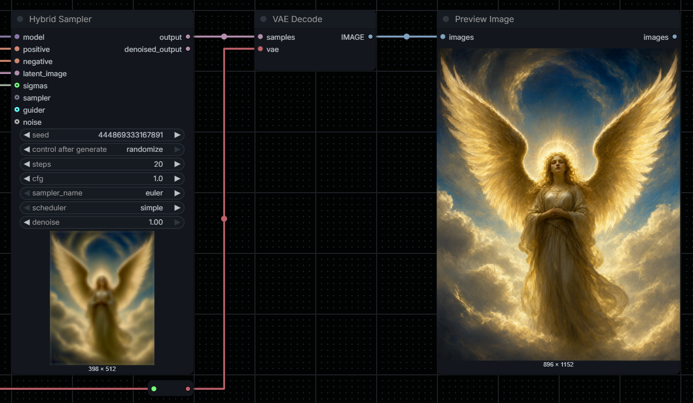

<div align="center">

# ComfyUI Hybrid Sampler
**Custom SamplerCustomAdvanced node with the same and new features as KSampler.**


</div>

A compact KSampler-style alternative to SamplerCustomAdvanced, with optional component overrides.

## Latest release
### 1.0
Added
- Initial commit

# Installation

### Git
Open a terminal inside the ComfyUI `custom_nodes` directory and clone the repository:

```bash
cd ComfyUI/custom_nodes
git clone https://github.com/VictorDmAlves/comfyui-hybrid-sampler.git
```

### ZIP
1. Download the repository as a ZIP file.
2. Extract it into `ComfyUI/custom_nodes/`.
3. Make sure the final structure is not nested twice.

Restart ComfyUI and add **Hybrid Sampler** from `sampling/custom_sampling`.

## Inputs
| Standard inputs | Type |
|---|---|
| model | MODEL |
| positive | CONDITIONING |
| negative | CONDITIONING |
| latent_image | LATENT |

Internal widgets: `seed` (native control-after-generate), `steps`, `cfg`, `sampler_name`, `scheduler`, `denoise`.

| Optional overrides | Type | Replaces |
|---|---|---|
| sigmas | SIGMAS | internal scheduler/steps/denoise sequence |
| sampler | SAMPLER | internal sampler_name |
| guider | GUIDER | internal model/positive/negative/cfg guidance |
| noise | NOISE | internal seed-based noise generator |

**Override precedence:** an optional connected input is used instead of its corresponding internal setting. When `guider` is supplied, it owns its model and conditioning; the model input remains useful for computing internal sigmas unless sigmas is also externally connected. When using an external guider with a different model, supply compatible sigmas explicitly.

Outputs: `output` (LATENT), `denoised_output` (LATENT).

## Native generation preview
The plugin calls `latent_preview.prepare_callback` and therefore uses the native ComfyUI preview mechanism. In ComfyUI settings, use **Preview method: auto**. Preview availability and quality depend on the active ComfyUI build, model architecture, and installed preview decoder. This displays the **in-progress latent preview**, not an extra IMAGE output or a guaranteed full-resolution image embedded at the bottom of the node. ComfyUI controls how/where the preview appears.

## Sample use cases (examples)
- **Standard**: connect MODEL, positive/negative, and LATENT; all other settings stay inside the node.
- **ManualSigmas**: connect `ManualSigmas -> sigmas`; internal steps/scheduler/denoise are ignored.
- **BasicScheduler**: connect `BasicScheduler -> sigmas`; the external scheduler provides the schedule.
- **Custom sampler**: connect a SAMPLER-producing node to `sampler`.
- **Advanced guidance**: connect a GUIDER-producing node; its model/conditioning/CFG are used.

## Notes
- This custom node does not implement new samplers. It uses ComfyUI's native `sampler_object`, `CFGGuider`, `calculate_sigmas`, and `guider.sample`.
- External SIGMAS determine actual sampling steps, even if the `steps` widget has another value.
- `denoise=0` produces a no-op only for the internal sigma path.
- `noise` override must provide `seed` and `generate_noise(latent)` as in the native NOISE type.
- Test on a current ComfyUI installation; the package has been statically validated but GPU sampling could not be run in the packaging environment.

## License
See [LICENSE](LICENSE).