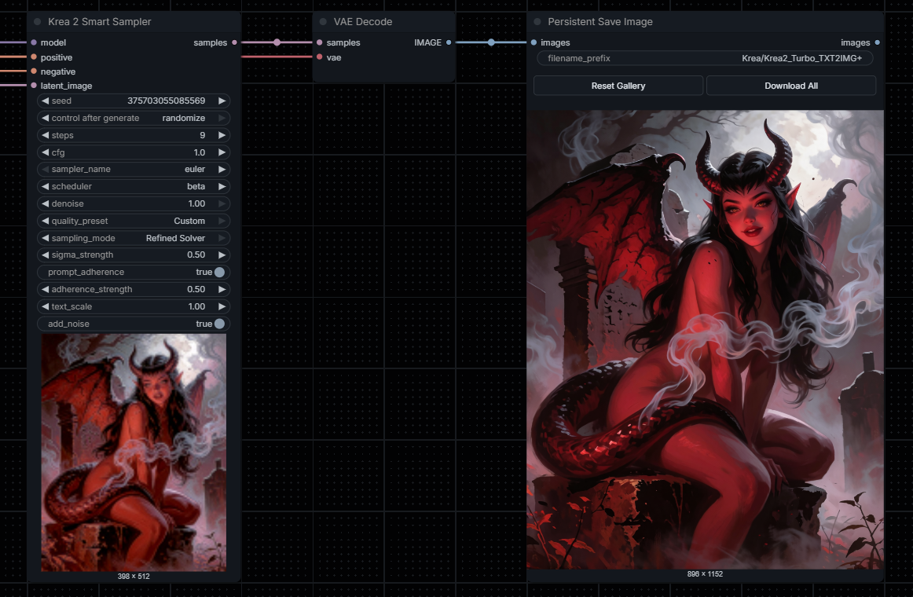

# ComfyUI Krea2 Smart Sampler
**Custom node for Krea2 Sampler, RAW and Turbo.**

Krea2 Smart Sampler is a custom sampler for ComfyUI designed to improve flexibility, image quality, and prompt adherence when working with Krea2 Turbo and RAW.

Inspired by the [MOSS Smart Sampler](https://github.com/VictorDmAlves/comfyui-moss-smart-sampler), it introduces multiple sampling strategies, including `Native Reference`, `Stage Weighted`, `Smooth Warp`, and `Refined Solver`, allowing users to experiment with different denoising approaches while maintaining full control over samplers and schedulers.

The node also includes quality presets optimized for Krea2 Turbo and RAW, ranging from fast generation to more refined outputs, as well as an optional Prompt Adherence feature that adjusts internal text conditioning to help the model follow prompts more closely.

Supporting both TXT2IMG and IMG2IMG, including second-pass refinement, Krea2 Smart Sampler combines these features into a single, easy-to-use node without requiring external sampling extensions.

## Quality presets
| Preset | Intended checkpoint | Steps | CFG (ComfyUI) | Notes |
| :-- | :-- | --: | --: | :-- |
| **Turbo** | **Krea 2 Turbo** | **8** | **1.0** | Reference recipe for distilled Turbo model |
| **Fast** | Krea 2 RAW | 25 | 4.5 | User-tested, speed-focused RAW starting point |
| **Balanced (default)** | Krea 2 RAW | 32 | 3.5 | Flexible starting point; also useful for second-pass experiments |
| **Quality** | Krea 2 RAW | 52 | 3.0 | User-tested RAW quality-oriented starting point |
| **Custom** | Either checkpoint | Manual | Manual | Keeps your edited Steps and CFG |

These presets only change **visible Steps and CFG**. They do not change the MODEL, sampler, scheduler, sampling mode, LoRA, flow shift, checkpoint, or resolution. Fast/Balanced/Quality are practical user-tested starting points rather than guaranteed improvements.

The Turbo preset **does not make RAW behave like the distilled Turbo checkpoint**. Load Krea2 Turbo upstream when using Turbo, and load Krea2 RAW upstream for Fast/Balanced/Quality. Custom can be used with either model.

## Controls (top to bottom)
**Base sampling:** Seed · Steps · CFG · Sampler · Scheduler · Denoise

**Quality:** Quality Preset (Turbo / Fast / Balanced / Quality / Custom)

**Smart sampling:** Sampling Mode · Sigma Strength

**Prompt adherence:** Prompt Adherence · Adherence Strength · Text Scale

**Advanced optional:** Add Noise

The seed retains native ComfyUI `control_after_generate` support. You can freely edit Steps and CFG after choosing a preset; the dropdown then shows **Custom**, so the settings shown in the UI always match the executed ones.

### Sampling modes
| Mode | Algorithm | Native sampler support |
| :-- | :-- | :-- |
| **Native Reference** | Same `comfy.sample.sample()` path as ComfyUI's KSampler | Any supported native sampler/scheduler |
| **Stage Weighted** | Adjusts positions of sigmas in the selected native schedule | Any supported native sampler/scheduler |
| **Smooth Warp** | Smooth, monotonic repositioning of sigmas | Any supported native sampler/scheduler |
| **Refined Solver** | One model call per step; Euler derivative with bounded historical AB2-style correction | **Euler only**, any supported scheduler |

`Sigma Strength` (0–1, default 0.5) controls only the three experimental modes; it is ignored by Native Reference. A stronger value means **a larger numerical change**, not necessarily higher quality.

`Prompt Adherence` is an independent text-fusion experiment and is **OFF** by default.

`Adherence Strength` controls fusion adjustment.

`Text Scale` scales internal `txtmlp` output (1.0 = neutral).

It may increase prompt fidelity but also affect contrast, style, lighting, and texture, and may add compute time. It does not disable content-safety filters and cannot guarantee every prompt will be followed. Avoid stacking it with other text-fusion patches until compatibility is verified.

### Flow shift and resolution
The node respects the loaded MODEL's `model_sampling` configuration. It does not override flow shift or change latent resolution. Check the model settings in your existing Turbo/RAW ComfyUI workflow.

## Compatibility and testing
- Requires a ComfyUI version with Krea2, native `comfy.samplers.KSampler`, and keyed model-patcher wrappers for Prompt Adherence.
- Supports standard 4D image latents and 5D Qwen/Wan-family encoded image latents (as produced by the Krea2 VAE), including IMG2IMG and second passes. This is an image sampler; it does not add video-model support.
- Uses one common mathematical sampling implementation for Turbo and RAW. The presets are merely suggested numerical settings.
- CPU backend tests use PyTorch and mocked ComfyUI APIs; JavaScript tests exercise a mocked LiteGraph node and cover v0.1.x, v1.0.0, and v1.0.1/v1.0.2 workflow loading. These tests do not replace running the models on a GPU.
- Run local tests with `python -m unittest discover -s tests -p 'test_cpu.py'` and `node tests/test_presets.cjs`.
- No additional pip dependencies beyond the existing ComfyUI installation.

## Sources and credits
- [Krea AI Krea 2 inference README](https://github.com/krea-ai/krea-2) — Turbo/RAW reference settings.
- [ComfyUI Krea 2 guide](https://docs.comfy.org/tutorials/image/krea/krea-2) and [native sampler implementation](https://github.com/Comfy-Org/ComfyUI/blob/master/comfy/samplers.py).
- Optional Prompt Adherence inspired by the MIT-licensed [ComfyUI-Krea2-Enhancer](https://github.com/K3nt3L/ComfyUI-Krea2-Enhancer). See `licenses/`.

## Third-party notices
As mentioned above, this plugin's experimental text-fusion adjustment is conceptually based on the **ComfyUI-Krea2-Enhancer** project, originally written by **Capitan01R**, and preserved by **K3nt3L**.

- Source: https://github.com/K3nt3L/ComfyUI-Krea2-Enhancer
- Upstream license: MIT

This implementation is independent and uses its own wrapper and integration code; the 12-tap enhancement coefficients, 24-chunk representation, and relative update cap were adapted from that project's public source. The original project retains its attribution and license terms.

## License
See [LICENSE](LICENSE).