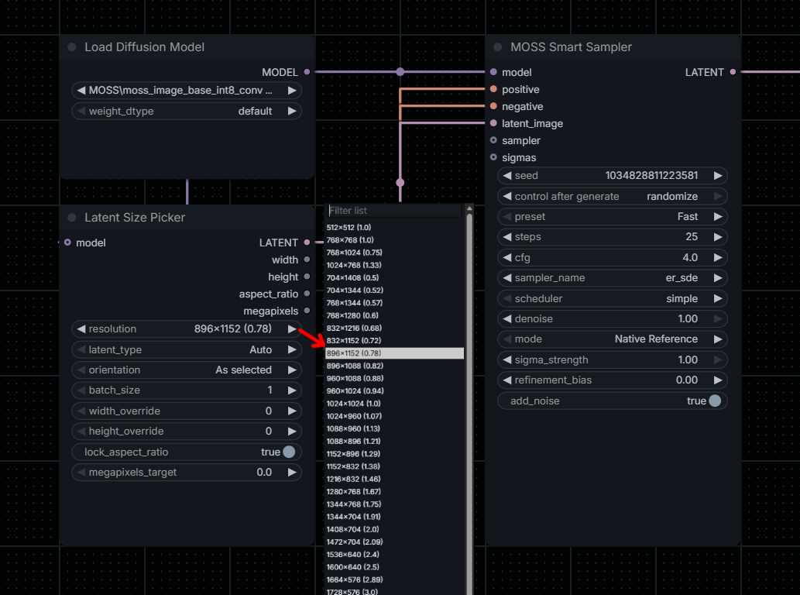

# ComfyUI Latent Size Picker
**All-in-one empty latent picker with complete features and support with all main models.**

Select an image resolution, optionally connect a ComfyUI `MODEL`, and produce an empty `LATENT` that matches the model's native latent architecture. The node also outputs the final width, height, aspect ratio, and megapixels so the dimensions can be reused elsewhere in a Workflow.

It is intended to replace a separate resolution picker followed by an additional empty-latent node.

# Auto support
Set `latent_type` to `Auto` and connect the native `MODEL` output. Detection reads the model's `latent_format` and associated metadata; it does **not** inspect checkpoint filenames, reload weights, or use guessed text matches as a fallback.

| Image model / family | Format detected | Native ComfyUI delegate | Latent layout |
| --- | --- | --- | --- |
| SD 1.5 / SD 2.x / SDXL / Illustrious | SD15 / SDXL | `EmptyLatentImage` | 4 channels, 8× compression |
| SD3 / SD3.5 | SD3 | `EmptySD3LatentImage` | 16 channels, 8× |
| FLUX.1 / Z-Image / Lumina 2 / Chroma FLUX-style / HiDream FLUX-style | Flux | `EmptySD3LatentImage` | 16 channels, 8× |
| Qwen Image (original / 2511 / 2512) | Wan21 (image family) | `EmptySD3LatentImage` | 16 channels, 8× |
| Anima / Krea 2 / JoyImage | Wan21 (image family) | `EmptySD3LatentImage` | 16 channels, 8× |
| FLUX.2 / FLUX.2 Klein / MOSS-Image / Ideogram 4 / Ernie Image / MageFlow | Flux2 | `EmptyFlux2LatentImage` | 128 channels, 16× |
| Qwen Image 2.1 | QwenImage21 | `EmptyLatentImage` + native `comfy.sample.fix_empty_latent_channels` | 64 channels, 16× |
| Hunyuan Image 2.1 (base) | HunyuanImage21 | `EmptyLatentImage` + native `comfy.sample.fix_empty_latent_channels` | 64 channels, 32× |

The two 64-channel paths deliberately invoke **ComfyUI's own** empty-latent conversion API; the plugin does not implement its own PyTorch latent allocator. Sizes for these models are rounded to 32-pixel multiples, and output `width`/`height` report the resulting values.

**Model-specific note:** For Qwen Image 2.1 **image editing**, the reference-aware native `TextEncodeQwenImage21` latent is preferred because it matches the first reference image size and carries its reference-conditioning contract. The picker is suitable for standalone text-to-image sizing, not as a substitute for the edit encoder's reference latent.

# Safety and limitations
Video/temporal, audio, 3D, layered, pixel-space, refiner-specific and as-yet-unknown latent formats are not automatically mapped. They produce a clear error instead of incorrectly falling back to an image latent.

This version does not attempt to replace Wan video latent nodes; video formats have frame-count/temporal requirements that the current UI does not expose. New formats can be explicitly integrated when an appropriate native path is available.

# Inputs
| Input | Default | Notes |
| --- | --- | --- |
| `model` (optional) | Not connected | Needed for `Auto`; accepts a ComfyUI `MODEL` / `ModelPatcher` |
| `resolution` | `1024x1024 (1.0)` | 36 built-in presets, including Essentials-style ratios |
| `latent_type` | `Auto` | `Auto`, `Standard (SD1.x / SDXL)`, `SD3 / FLUX.1 (16ch)`, `FLUX.2 / MOSS (128ch)` |
| `orientation` | As selected | As selected, Portrait, Landscape |
| `batch_size` | 1 | Number of empty latents |
| `width_override` | 0 | Zero keeps the preset width |
| `height_override` | 0 | Zero keeps the preset height |
| `lock_aspect_ratio` | true | If only one dimension is overridden, scale the other |
| `megapixels_target` | 0 | Zero disables megapixel resizing |

Standard size calculation rounds to multiples of 16. The 64-channel models align to 32. If both width/height overrides are set, they take priority over the ratio lock; the megapixel target (when enabled) scales the resulting aspect ratio.

# Outputs
| Output | Type | Purpose |
| --- | --- | --- |
| `LATENT` | LATENT | Empty native-format image latent |
| `width` | INT | Final pixel width |
| `height` | INT | Final pixel height |
| `aspect_ratio` | FLOAT | Final width divided by height |
| `megapixels` | FLOAT | Final image megapixels |

# Compatibility
No external Python package dependencies or web assets are added. All latent generation and conversion are delegated to installed ComfyUI code. A sufficiently recent ComfyUI is required for FLUX.2, Qwen Image 2.1 and Hunyuan Image 2.1.

# Sources
- [ComfyUI — Native Empty Latent Image (`nodes.py`)](https://github.com/Comfy-Org/ComfyUI/blob/master/nodes.py)
- [ComfyUI — Native SD3 empty latent (`nodes_sd3.py`)](https://github.com/Comfy-Org/ComfyUI/blob/master/comfy_extras/nodes_sd3.py)
- [ComfyUI — Native FLUX.2 empty latent (`nodes_flux.py`)](https://github.com/Comfy-Org/ComfyUI/blob/master/comfy_extras/nodes_flux.py)
- [ComfyUI — Native empty-latent adjustment (`comfy/sample.py`)](https://github.com/Comfy-Org/ComfyUI/blob/master/comfy/sample.py)
- [ComfyUI — Latent formats, channel counts and compression ratios](https://github.com/Comfy-Org/ComfyUI/blob/master/comfy/latent_formats.py)
- [ComfyUI — Supported model mappings](https://github.com/Comfy-Org/ComfyUI/blob/master/comfy/supported_models.py)
- [ComfyUI — Native Qwen Image 2.1 encoder/latent](https://github.com/Comfy-Org/ComfyUI/blob/master/comfy_extras/nodes_qwen.py)
- [ComfyUI — Official MOSS-Image TXT2IMG template](https://github.com/Comfy-Org/workflow_templates/blob/main/templates/image_moss_image_t2i.json)
- [VicNodes — Module auto-loading convention](https://github.com/VictorDmAlves/comfyui-vicnodes/blob/main/__init__.py)

# License
See [LICENSE](LICENSE).