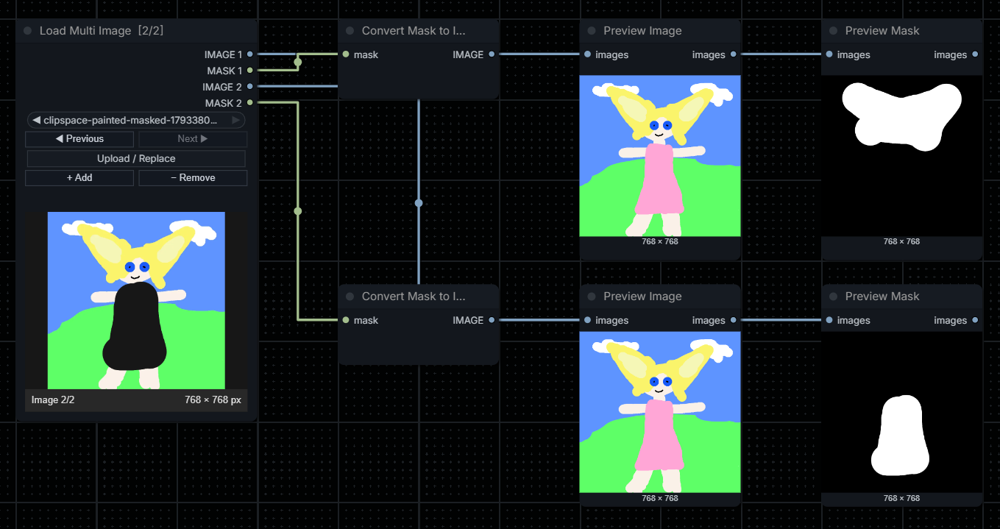

<div align="center">

# ComfyUI Load Multi Image
**Custom node for loading multiple images in one node.**


</div>

An enhanced **Load Image** node with multiple independent image slots and compact navigation.

## Latest release
### 1.1
Update
- Removed the empty space that existed between the selectors and the image in the node.
- Reordered the selectors and button on the node.

## Features
- One node for up to **5 images** by default; configurable from 1 to 32.
- Side-by-side **Previous / Next** buttons to browse selected images in a single on-node preview, with the active image resolution shown in pixels.
- Side-by-side **Add image slot** and **Remove last slot** buttons, plus **Upload / Replace** or drag-and-drop (multiple files can be selected at once).
- **Native Mask Editor on each active image** through the right-click preview menu; saving updates only that slot.
- **Independent IMAGE and MASK ports** for each added slot: `IMAGE 1`, `MASK 1`, `IMAGE 2`, `MASK 2`, etc.
- Each IMAGE port can go to a different `VAE Encode` or other image-processing branch; each MASK can be wired separately to inpaint/mask operations.
- Reuses ComfyUI's native loader and upload endpoint. Honors EXIF orientation, transparency and formats supported by core `LoadImage`.
- Saves image selections, number of slots, and current preview index with the Workflow.
- No additional Python libraries to install beyond the ones already used by ComfyUI.

## Installation

### Git
Open a terminal inside the ComfyUI `custom_nodes` directory and clone the repository:

```bash
cd ComfyUI/custom_nodes
git clone https://github.com/VictorDmAlves/comfyui-load-multi-image.git
```

### ZIP
1. Download the repository as a ZIP file.
2. Extract it into `ComfyUI/custom_nodes/`.
3. Make sure the final structure is not nested twice.

Restart ComfyUI and add **Load Multi Image** from `extensions/VicNodes/Load Multi Image`.

## Quick start
1. In slot 1, select an existing image using the filename picker, click **Upload / Replace**, or drop an image onto the node.
2. Click **+ Add image slot** to create slot 2 and its two new ports.
3. Select or upload the second image; use **Previous image** / **Next image** to swap the displayed image.
4. Connect `IMAGE 1` to one `VAE Encode` node and `IMAGE 2` to another. Each image has its own `MASK` output.
5. Optional: select/drop several image files at once. The first replaces the current slot, and the others fill empty subsequent slots or create new ones, up to the configured maximum. Use Previous / Next to inspect each image's pixel dimensions.

## Changing the image limit
Edit `config.json`:

```json
{
  "max_images": 8
}
```

Then **restart ComfyUI and hard-refresh the browser**. The configured maximum changes the backend node's output schema; it cannot safely be changed at runtime.

Increase it freely, but **do not decrease it below the number of slots already used in saved Workflows**; doing so would invalidate connections to removed outputs.

## Behavior
- Slots may be added up to the configured limit, but the UI only **removes the last slot** to prevent unexpected rewiring of numbered output sockets.
- When removing a last slot with connected outputs, a confirmation is shown before disconnecting its wires.
- Each missing/non-selected slot emits a harmless black `64×64` IMAGE and zero MASK placeholder internally. Connect only populated slots. **Slot 1 must contain a valid image to execute.**
- An opaque image produces a full-size zero mask. Transparent pixels are mapped to white/1 in the MASK output, following normal ComfyUI mask polarity.
- The image selector lists top-level files from `ComfyUI/input`, as with the stock Load Image node. Uploads also go to the standard `input` folder. This version does not offer a folder browser.
- A changing source image at the same filename is detected using a content hash.
- The frontend uses LiteGraph/ComfyUI classic node hooks; UI appearance can vary with frontend releases.
- Image dimensions reflect the source resolution returned by the image-view endpoint, not the scaled-on-screen preview. Drag/drop supports image files from the file system, not every browser-specific dragged URL or ComfyUI gallery object.

## License
See [LICENSE](LICENSE).
