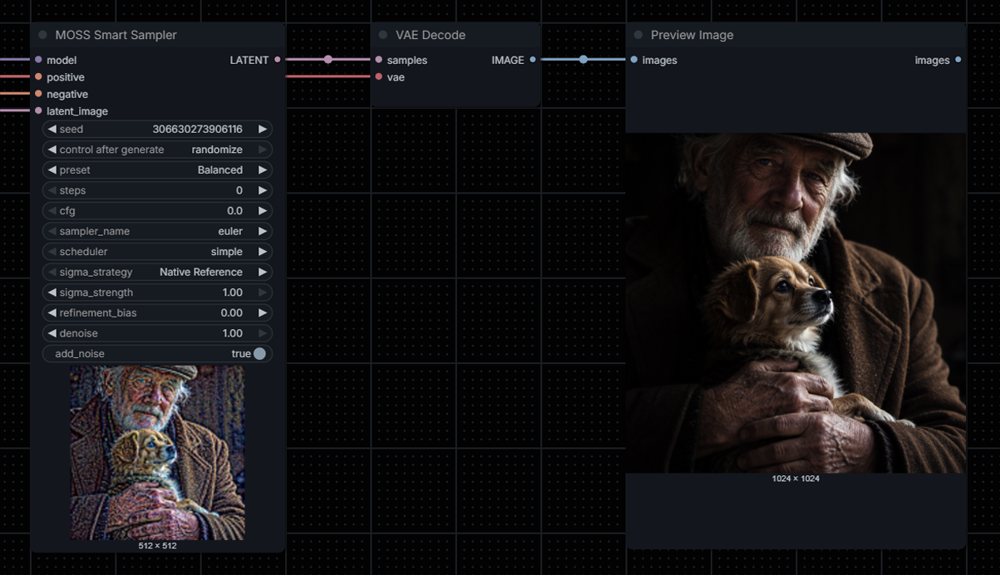

<div align="center">

# ComfyUI MOSS Smart Sampler
**Custom node for MOSS Sampler Base, SFT and Turbo.**


</div>

A focused sampler node for **MOSS-Image Base, SFT and Turbo(LoRA)** in ComfyUI. It can reproduce a native ComfyUI sigma schedule or redistribute sampling positions using **Stage Weighted** or **Smooth Warp**. An adjustable **Sigma Strength** lets you blend either experimental curve back toward the native schedule.

> **Quality notice:** Sampling schedules produce different results, not guaranteed improvements. Tests have shown some aesthetically appealing variations and some regressions. Compare fixed prompts and seeds before using a strategy as your default.

## Latest release
### 1.2.0
- Added optional external `SAMPLER` and `SIGMAS` inputs.
- Reordered the node widgets and renamed `sigma_strategy` to `mode`.
- No changes to the underlying sampling algorithms.

# Features
- Single node; no additional helper nodes, subgraphs or Nodes 2.0 required.
- Five profiles **Fast, Balanced, Realism, Quality, Turbo** plus **Custom** for manual Steps/CFG values.
- Three sigma strategies: **Native Reference, Stage Weighted, Smooth Warp**.
- **Sigma Strength** (`0.00`–`1.00`) directly below Sigma Strategy in the node UI.
- Native sampler choices: **euler**, **er_sde**, **sa_solver**.
- Native scheduler choices: **simple**, **sgm_uniform**, **beta**.
- Respects the incoming MODEL's sampling shift; does not reapply shift or modify ComfyUI internals.
- Works with LoRA-patched MOSS models; uses the ComfyUI sampling, noise, masks and preview callbacks (including global **Preview Method: Auto**).
- No custom AB2/AB3/Adaptive integrators or experimental noise reinjection.

# Quick start
**Turbo (MOSS SFT + compatible 8-step Turbo LoRA):** choose `Turbo` (fills `steps=8`, `cfg=1.0`), `sampler_name=euler`, `scheduler=simple`, `sigma_strategy=Native Reference`, `denoise=1.0`, `add_noise=true`. This resolves to **8 steps** and **CFG 1.0**. Switch to Smooth Warp or Stage Weighted with Sigma Strength at `0.50`, `0.75` or `1.00` to explore variations using the **same seed**.

**Standard (MOSS Base/SFT without a Turbo LoRA):** begin with `Balanced`, `steps=35`, `cfg=4.0`. You can use your preferred native sampler/scheduler combination, such as `sa_solver + sgm_uniform`, then compare the three sigma strategies while keeping other settings fixed.

**Preset names are targets, not quality guarantees.** The four Standard presets differ in their default steps and in the experimental sigma-curves they generate; the default CFG is 4.0 for all four. Turbo has a separate eight-step curve and default CFG 1.0. Selecting a profile **fills Steps and CFG** in the UI. Editing either field switches the label to **Custom**, while retaining the sigma profile of the last selected preset. Older API workflows may still send zero for automatic preset values.

# Controls and tooltips
| Control | Actual behavior |
|---|---|
| `MODEL` | MOSS-Image Base or SFT MODEL, already patched with any applicable LoRAs; existing shift is inherited |
| `positive` / `negative` | ComfyUI conditioning inputs; at CFG 1.0, negative prompt guidance generally has no effect |
| `latent_image` | Empty or encoded latent; carries size and optional batch/mask information |
| `seed` | Starting-noise seed; use a fixed value to compare schedules |
| `preset` | Fast / Balanced / Realism / Quality / Turbo / Custom; Custom preserves the sigma profile of the last selected preset |
| `steps` | Defaults to 35; profile selection fills Steps; manual edits select Custom; legacy zero auto remains supported for named presets |
| `cfg` | Defaults to 4.0; profile selection fills CFG; manual edits select Custom; legacy zero auto remains supported for named presets |
| `sampler_name` | `euler`, `er_sde`, `sa_solver`; user-selected, not secretly changed |
| `scheduler` | `simple`, `sgm_uniform`, `beta`; determines the native reference curve |
| `sigma_strategy` | Native Reference = unchanged curve; Stage Weighted = three stages; Smooth Warp = continuous redistribution |
| `sigma_strength` | `0.0` Native → `1.0` original experimental curve; ignored for Native Reference |
| `refinement_bias` | `-1.0` to `+1.0`, shifts experimental emphasis earlier/later; `0.0` is original; ignored for Native Reference |
| `denoise` | `1.0` full schedule; values under `1.0` partial schedule; `0.0` returns input unchanged |
| `add_noise` | `true`: seeded noise; `false`: zero starting noise |
| Output | `LATENT` |

Preset defaults:
| Preset | Auto steps | Auto CFG |
|---|---:|---:|
| Fast | 25 | 4.0 |
| Balanced | 35 | 4.0 |
| Realism | 40 | 4.0 |
| Quality | 50 | 4.0 |
| Turbo | 8 | 1.0 |
| Custom | Manual | Manual |

# Sigma algorithms
The node starts from the selected native ComfyUI scheduler for the model's own `model_sampling`. For Stage Weighted and Smooth Warp, it generates an alternative curve from the native sigma values. It does **not** calculate an independent Flow shift.

```python
sigma_out = native_sigmas + sigma_strength * (candidate_sigmas - native_sigmas)
```

- `Native Reference` always uses the native sigmas, regardless of Sigma Strength or Refinement Bias.
- `Sigma Strength = 0.0` uses the native sigmas exactly.
- `Sigma Strength = 1.0` uses the **original** Stage Weighted or Smooth Warp formula retained from v0.1.x–v0.5.x.
- Intermediate strengths interpolate **sigma values**, not image pixels or generated details.
- No additional denoiser evaluations or speed improvements are claimed.

`refinement_bias` changes the candidate experimental curve; leave it at `0.0` when comparing Sigma Strength values. The chosen `sampler_name` and `scheduler` remain independent user controls.

# Acknowledgements
- **ComfyUI** and its contributors for the native sampling infrastructure and MOSS-Image support.
- **MOSS-Image** developers for the base architecture and weights.
- **Martin Rizzo's [ComfyUI-ZImagePowerNodes](https://github.com/martin-rizzo/ComfyUI-ZImagePowerNodes)** for inspiring exploration of multi-stage schedules. This plugin does not copy Z-Sampler sigmas or require ZImagePowerNodes.

# Sources
- **[MOSS-Image — Official Repository](https://github.com/OpenMOSS/MOSS-Image)** — Model architecture and recommended sampling configurations.
- **[MOSS-Image Technical Report](https://arxiv.org/abs/2610.23374)** — Technical background on the MOSS-Image model.
- **[ComfyUI — Native Samplers](https://github.com/Comfy-Org/ComfyUI/blob/master/comfy/samplers.py)** — Native sampling algorithms and sigma scheduling.
- **[ComfyUI — Custom Sampling Nodes](https://github.com/Comfy-Org/ComfyUI/blob/master/comfy_extras/nodes_custom_sampler.py)** — Reference for custom samplers and external sigma schedules.
- **[Elucidating the Design Space of Diffusion-Based Generative Models](https://arxiv.org/abs/2206.00364)** — Research background on diffusion sampling and noise schedules.

**Stage Weighted** and **Smooth Warp** are experimental sigma scheduling strategies developed specifically for this project, rather than direct implementations of the referenced papers.

Special thanks to the **OpenMOSS** and **ComfyUI** teams for their open-source contributions.

# License
See [LICENSE](LICENSE).