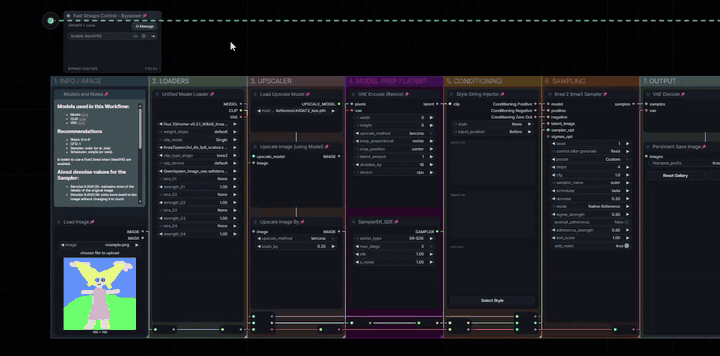

# ComfyUI Node Follow Path
**Select the node, set a path, and watch it follow along with you throughout the entire Workflow.**

  

**Node Follow Path** is a frontend extension for **ComfyUI** that keeps selected nodes accessible as you navigate large **Workflows**, while restricting their movement to an adjustable path.

# Features
- **Horizontal (X)** and **Vertical (Y)** movement with configurable distance and direction.
- **Both Axes (L Path)**: two perpendicular segments meet at the saved origin. The node remains on one segment and returns through the origin before switching branches. No diagonal movement and no rectangular free-roaming area.
- **Directly editable path preview**: drag the teal origin to move the start; drag the amber X/Y endpoints to change distance and direction. All handles have larger hover/click targets.
- **Unobtrusive overlay**: thin dashed lines only; the preview can be hidden independently of movement.
- **Zoom compensation** and predictable endpoint limits. Distances use **Workflow canvas units**, not screen pixels.
- **Per-node settings**, a compact editor, flat actions in the node context menu, and restoration to the saved origin.
- **Workflow persistence**: path settings and original node position are written to the saved Workflow, not the transient follow position.
- **Continuous tracking across Workflow tabs**: changing tabs keeps the node at its last displayed point on the path, without resetting it to the origin. The original origin/endpoints remain unchanged and the node resumes tracking when revisited, even at high zoom.

# How it works
1. Select an existing node in a classic-canvas **Workflow**.
2. Open the node menu and choose **Follow Path: Configure...**.
3. Enable movement, choose **Horizontal (X)**, **Vertical (Y)** or **Both Axes (L Path)**, and set the distances/directions.
4. Enable **Show path preview on canvas** to view the path; drag its handles directly on the canvas or enter values in the editor.
5. Navigate the canvas normally. The selected node follows within its finite path. Turning off the preview does **not** disable the movement.

In Both Axes, the current navigation target is projected onto the closest valid branch, with a small preference for the currently active branch to prevent rapid axis changes. To switch axes, the node travels back through the shared origin; it never takes a diagonal shortcut.

# Node menu commands
- `Follow Path: Configure...` — open the editor.
- `Follow Path: Enable` / `Follow Path: Disable` — toggle the movement.
- `Follow Path: Show Path Preview` / `Follow Path: Hide Path Preview` — show or hide the guides and draggable handles.
- `Follow Path: Restore Original Position` — return to the saved origin and disable movement.

# Settings
| Setting | Description |
| --- | --- |
| Enable movement | Activate/deactivate the tracking behavior for the selected node. |
| Movement mode | Horizontal, Vertical or Both Axes (L Path). |
| Horizontal / vertical distance | Maximum displacement from the saved origin in Workflow canvas units. |
| Direction X / Y | Right/left and down/up. |
| Show path preview | Show lines and draggable handles without changing the tracking rules. |
| Restore origin | Return the node to its saved start position and disable tracking. |

# Technical notes
- Configuration is stored per node at `node.properties.vic_follow_path` (schema version `1`, unchanged from v0.1.x).
- Runtime follow positions for remounted nodes are cached in memory per graph, not written to Workflow properties. These snapshots only support the same graph instance; a wholly replaced graph still starts from its saved position.
- A per-node serialization callback preserves the original node position (`pos`) in the saved Workflow, and delegates to any existing serialization callback.
- Movement is calculated client-side from the LiteGraph camera (`offset` and `scale`) and constrained in Workflow coordinates.
- The overlay uses SVG to display paths and drag handles; no rectangular shaded canvas layer is drawn.
- This module has no runtime dependency on Fast Groups Control or rgthree.

# Sources
- [ComfyUI Frontend](https://github.com/Comfy-Org/ComfyUI_frontend) — official frontend implementation and extension lifecycle.
- [ComfyUI Core Extensions: Workflow Tab Lifecycle](https://github.com/Comfy-Org/ComfyUI_frontend/blob/main/docs/extensions/core.md) — per-Workflow graphs and the `afterLoadGraph` lifecycle on tab switches.
- [ComfyUI Frontend Extension Development Guide](https://github.com/Comfy-Org/ComfyUI_frontend/blob/main/docs/extensions/development.md) — extension structure and JavaScript loading.
- [ComfyUI JavaScript Extension Examples](https://docs.comfy.org/custom-nodes/js/javascript_examples) — context menus and frontend hooks.
- [ComfyUI Context Menu Migration](https://docs.comfy.org/custom-nodes/js/context-menu-migration) — node context-menu interfaces.
- [ComfyUI Serialization Callbacks Migration](https://docs.comfy.org/custom-nodes/js/serialization-callbacks-migration) — compatibility guidance for serialization hooks.
- [ComfyUI Node Geometry Migration](https://docs.comfy.org/custom-nodes/js/node-geometry-migration) — geometry handling and node positioning.
- [ComfyUI LiteGraph DragAndScale](https://github.com/Comfy-Org/ComfyUI_frontend/blob/main/src/lib/litegraph/src/DragAndScale.ts) — pan, zoom and coordinate calculations.

# License
See [LICENSE](LICENSE).