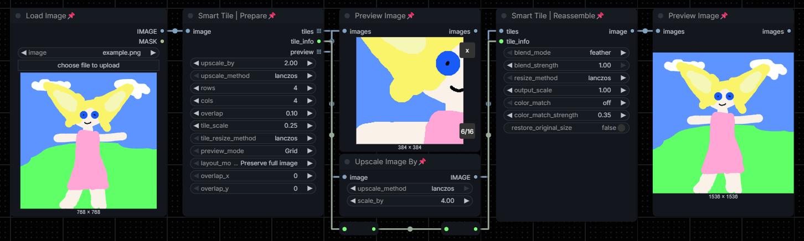
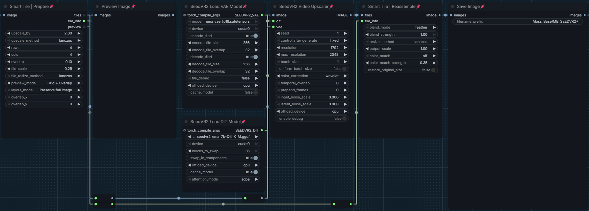

<div align="center">

# ComfyUI Smart Tile Upscaler
**Further enhance the quality of your upscaling with Tile method and SeedVR2.**


</div>

Smart Tile Upscaler is a flexible, two-node tiling and image reconstruction system for ComfyUI, designed to simplify high-resolution image enhancement Workflows using external upscalers such as SeedVR2.

Instead of relying on multiple nodes to resize, split, overlap, process, and reconstruct an image, Smart Tile Upscaler consolidates the entire tiling pipeline into two dedicated nodes.

# Why Smart Tile Upscaler?
Processing large images can be demanding on GPU memory, especially when using advanced AI upscaling models. By splitting an image into smaller, manageable regions, Smart Tile Upscaler enables high-resolution enhancement while giving users greater control over how each region is processed.

The system is designed to work alongside existing upscalers rather than replace them. SeedVR2 handles the actual image enhancement, while Smart Tile Upscaler takes care of everything before and after it.

With customizable tile grids, overlap control, multiple preview modes, automatic reconstruction, and flexible blending options, the goal is simple: less workflow complexity, greater flexibility, and high-quality results.

>Recommended Workflow: For the best results, consider using a second sampling pass to refine image details before applying Tile Upscaling with SeedVR2. This step is optional when the source image already has sufficient resolution and visual quality.

# Nodes
| Node | ID | Purpose |
|---|---|---|
| **Smart Tile \| Prepare** | `VicSmartTilePrepare` | Upscale input, create overlapping tiles, and emit an **IMAGE list**, reconstruction metadata, and a **clickable clean tile-preview IMAGE list** |
| **Smart Tile \| Reassemble** | `VicSmartTileReassemble` | Receive the processed IMAGE list plus metadata; resize, blend and reconstruct the full image |

# Wiring

```text
VAE Decode / second sampler (IMAGE)
         |
         v
Smart Tile | Prepare ---- preview (IMAGE LIST) ----> Preview Image [clickable gallery]
         |                
         |-- tiles (IMAGE LIST) --> SeedVR2 Video Upscaler (image)
         |                                     |
         |                                     v
         |                             processed IMAGE LIST
         |                                     |
         |-- tile_info (VIC_TILE_INFO) --------+---> Smart Tile | Reassemble
                                                    |
                                                    v
                                               Save Image
```

**Recommended input Workflow:** For best detail, it is generally recommended to **use a second sampler/refinement pass before Smart Tile + SeedVR2** (typically after your first generation pass and before its VAE Decode feeds Prepare). If the input image is **already sufficiently large and high quality**, this extra sampler is **optional**: connect the high-quality image directly to Prepare. An extra pass is not a prerequisite for the nodes to work.

**Important:** Feed `tiles` directly into the SeedVR2 input. Feed its `IMAGE` output directly to `Reassemble.tiles`. **Do not** put an Image List to Batch node between these nodes. The list tells ComfyUI to run SeedVR2 **independently for each tile** (one image/frame per execution); sending the whole group as one batch risks temporal interference. Keep tile order unchanged.

The VAE/DiT loaders connect directly to SeedVR2 and remain independent of these nodes. The SeedVR2 `batch_size=1` setting is recommended for this image-by-image Workflow.

# Example with SeedVR2


# Default values
| Smart Tile Prepare | Default |
|---|---:|
| `upscale_by` | `2.00` |
| `upscale_method` | `lanczos` |
| `rows / cols` | `4 / 4` |
| `overlap` | `0.10` |
| `tile_scale` | `0.25` |
| `tile_resize_method` | `lanczos` |
| `preview_mode` | `Grid` (clean core-tile gallery) |
| `layout_mode` (Advanced) | `Preserve full image` |
| `overlap_x / overlap_y` (Advanced) | `0 / 0` |

# Clickable tile preview
Connect the Prepare **`preview`** output to the normal ComfyUI **Preview Image** node. The preview output is a genuine **IMAGE list**. ComfyUI renders its images as a gallery that you can click to inspect one tile at a time. Tiles are displayed in **row-major order** (top-left to bottom-right), just like the SeedVR2 processing order. The `tiles` output for SeedVR2 and `tile_info` data are not changed by preview settings.

| `preview_mode` | Images sent to Preview Image |
|---|---|
| `Grid` (**default**) | One **core crop per tile**, without overlap margins; useful for inspecting each quadrant alone |
| `Grid + Overlap` | One **full tile with its overlap area** per image, prior to `tile_scale`; no lines drawn |
| `Original` | The **whole prepared image**, once per source image, without any guides or marks |
| `SeedVR2 Input` (**new**) | The **exact smaller tiles** being sent to SeedVR2, after `tile_scale` and `tile_resize_method` |

For a 4 × 4 grid, the first, second, and fourth modes show **16 previews** per input image; `Original` shows **1**. No custom frontend extension is required. The output also supports uneven edge dimensions (unlike a single IMAGE batch), which matters with `Preserve full image`.

These are **two different resize stages**: first scale the whole image by 2×, then scale each cut tile by 0.25× before SeedVR2. The metadata retains the larger pre-tile-resize coordinates, and the second node uses them for reconstruction.

# Prepare outputs
- **tiles** (`IMAGE`, **LIST**): ordered row-first, left-to-right, top-to-bottom; each entry is a **batch of one image**, as SeedVR2 expects.
- **tile_info** (`VIC_TILE_INFO`): includes the grid, original and prepared sizes, number of input images, exact tile/core rectangles, overlaps and processing order. Do not insert a conversion node.
- **preview** (`IMAGE`, **LIST**): connect to the stock Preview Image node to see an interactive gallery of **clean, individual images**. `preview_mode` chooses whether those are cores, overlap tiles, original canvas, or the exact SeedVR2 inputs. The preview is not fed back into the upscaler.

# Reassemble settings
| Setting | Default | Description |
|---|---|---|
| `blend_mode` | `feather` | Normalized linear weights across tile fringes; `cosine` has smoother ramps; `legacy` uses sequential Essentials-style fades; `hard` uses the nonoverlapping tile cores |
| `blend_strength` | `1.00` | Portion of the available fringe used for feathering; 0 effectively hard-cuts for `feather`/`cosine` |
| `resize_method` | `lanczos` | Resize each SeedVR2 result to exact tile coordinates before assembly |
| `output_scale` | `1.00` | Optional final resize of the whole assembled image |
| `color_match` (Advanced) | `off` | Optional conservative overlap mean adjustment; test carefully, because it can shift tones |
| `color_match_strength` (Advanced) | `0.35` | Strength of the optional color correction |
| `restore_original_size` (Advanced) | `false` | Resize back to the input size before `upscale_by`; applied before `output_scale` |

# Layout modes
- `Preserve full image` (**default**): partitions the entire prepared canvas, including odd-width/-height border pixels. Interior tiles may have different sizes; this is safe because they are processed as separate IMAGE list entries.
- `Essentials compatible`: reproduces the placement formula in ComfyUI Essentials **Image Tile**. For nondivisible image dimensions, the final 0–(cols–1) right pixels and 0–(rows–1) bottom pixels can be discarded, matching the reference. Select this to compare results with your current node chain; select `legacy` in Reassemble for a closer reproduction of the original blending.

**Overlap note:** `overlap` is a fraction of the **base tile size**. The actual intersection area of neighboring tiles can be larger than that parameter because two expanded tile areas can overlap. This intentionally reflects the reference Image Tile semantics.

# Limits / cautions
- Do not put Image List to Image Batch between the nodes. Every SeedVR2 execution should handle one tile.
- The preview can contain many large individual images, so rendering all tiles in the native Preview Image node may take more memory than previewing one small composite. Change `preview_mode` to `Original` if a quick full-frame check is sufficient.
- The maximum is 256 tiles across all input images, as a safety cap. Very large grids or giant upscaled canvases can exhaust RAM/VRAM even if the reconstruction logic is correct.
- RGBA inputs are supported as far as the bridge is concerned; verify actual RGBA support and output channels of your SeedVR2 model.
- The order of a list cannot be encoded in the resulting tensor itself, so an intermediate node that **sorts/reorders** images will cause incorrect tile placement. Keep outputs connected directly.
- `legacy` performs sequential blending; `feather` and `cosine` perform normalized weight blending. They are not expected to be pixel-for-pixel identical to the existing workflow after SeedVR2 processing.

# Sources
- [ComfyUI — List Processing](https://docs.comfy.org/custom-nodes/backend/lists): expected behavior of `OUTPUT_IS_LIST` / `INPUT_IS_LIST` and why IMAGE lists differ from batches.
- [ComfyUI Frontend — ImagePreview.vue](https://github.com/Comfy-Org/ComfyUI_frontend/blob/main/src/renderer/extensions/vueNodes/components/ImagePreview.vue): native clickable grid/gallery presentation for multiple preview images.
- [ComfyUI — Native ImageScaleBy (`nodes.py`)](https://github.com/Comfy-Org/ComfyUI/blob/master/nodes.py): native image resize semantics and methods.
- [ComfyUI Essentials — Image Tile and Image Untile (`image.py`)](https://github.com/cubiq/ComfyUI_essentials/blob/main/image.py): tile placement, overlap interpretation, and legacy fade baseline.
- [SeedVR2 Video Upscaler](https://github.com/numz/ComfyUI-SeedVR2_VideoUpscaler): external upscaler integration; no source copied into this module.
- [ComfyUI Issue #16129 — SeedVR2 image upscaling breaks batched images](https://github.com/Comfy-Org/ComfyUI/issues/16129): motivation for separate IMAGE-list processing of unrelated frames/tiles.
- [VicNodes Repository](https://github.com/VictorDmAlves/comfyui-vicnodes): folder-based automatic module discovery via the package's existing `__init__.py`.

# License
See [LICENSE](LICENSE).