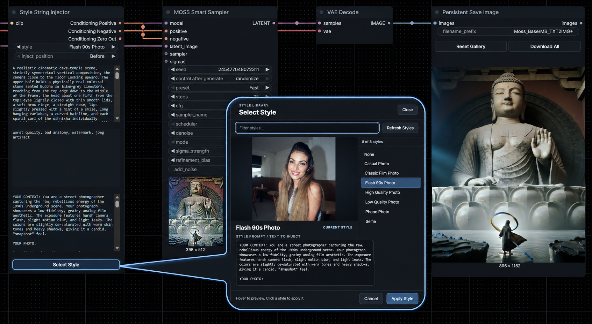

<div align="center">

# ComfyUI Style String Injector
**A visual style gallery and native CLIP conditioning encoder for ComfyUI.**


</div>

A visual style gallery and native CLIP conditioning encoder for ComfyUI.

I’ve included a few styles as an example.

# Features
- CLIP input plus **Conditioning Positive**, **Conditioning Negative** and **Conditioning Zero Out** outputs.
- Style dropdown with **None** as default and built-in search.
- **Select Style**: full-width VicNodes dark outlined button, styled like Persistent Save Image.
- In the gallery, hover to preview a style photograph and the full text being injected. Search, choose or refresh styles.
- Inject before or after the editable **Positive** field; **Negative** remains unchanged.
- Read-only live **Preview** for the combined positive prompt.
- Uses ComfyUI native `CLIPTextEncode` and `ConditioningZeroOut`.
- Local `.txt` + `.png/.jpg/.jpeg/.webp` pairs; no external requirements.

# Style library
Place two files with the same filename (other than extension) inside **`modules/style_string_injector/styles/`**:

```text
Vintage Photo.txt
Vintage Photo.webp
```

The filename `Vintage Photo` becomes the style label. Use UTF-8 in the text file. Supported image extensions: `.png`, `.jpg`, `.jpeg`, `.webp`.

You can update the styles in an already open Workflow using **Select Style > Refresh Styles**. The browser gallery is read-only; new styles must be added to disk.

# Sources
- [Z-Image PowerNodes — concept and style browser reference](https://github.com/martin-rizzo/ComfyUI-ZImagePowerNodes)
- [ComfyUI native nodes — CLIPTextEncode, ConditioningZeroOut](https://github.com/Comfy-Org/ComfyUI/blob/master/nodes.py)
- [ComfyUI frontend extension docs](https://github.com/Comfy-Org/ComfyUI_frontend/blob/main/docs/extensions/core.md)
- [ComfyUI widget serialization guidance](https://github.com/Comfy-Org/ComfyUI_frontend/blob/main/docs/WIDGET_SERIALIZATION.md)

# License
See [LICENSE](LICENSE).
