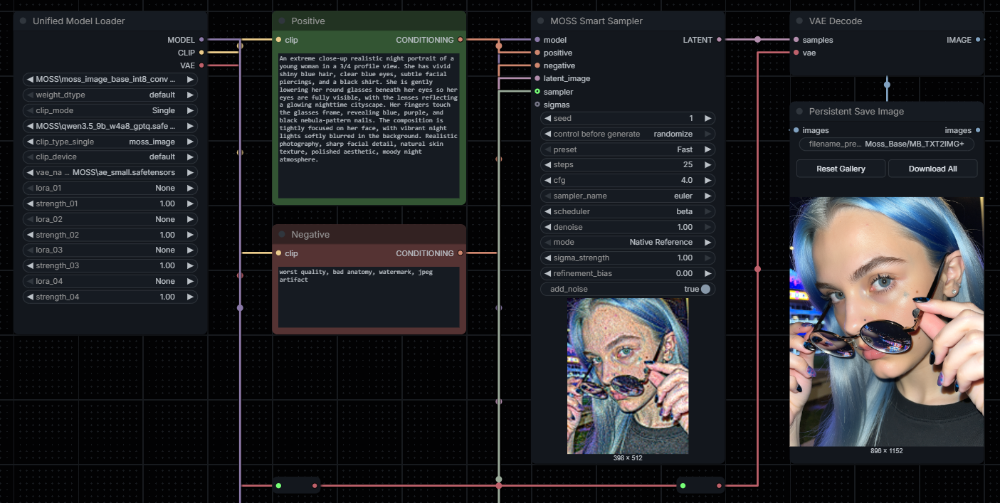

# ComfyUI Unified Model Loader
**A compact ComfyUI node that combines the four native nodes in one.**

A compact ComfyUI custom node that combines the native **Load Diffusion Model**, **Load CLIP**, **Load CLIP (Dual)**, **Load VAE** and four sequential **Load LoRA** operations into a single node.

This project **delegates the actual loading and LoRA patching to ComfyUI's built-in nodes**. It does not implement its own model loading, quantization, CLIP recipe or LoRA algorithm.

# Features
- Three native output types: `MODEL`, `CLIP`, and `VAE`.
- Select a diffusion model and its native `weight_dtype` options.
- Choose `Single` CLIP or `Dual` CLIP. The second encoder and the appropriate CLIP type selector are displayed only in Dual mode (when the optional JS extension is active).
- CLIP type lists are read directly from the installed ComfyUI core nodes. This includes additional types such as `moss_image` **when the installed ComfyUI version supports them**.
- Native VAE selector, including any VAE variants supported by the current core VAELoader.
- Four LoRA slots in order `01 -> 02 -> 03 -> 04`; choose `None` or a strength of `0` to skip.
- One strength per LoRA applied to **both** the MODEL and CLIP, following native `LoraLoader` behavior.
- No external Python dependencies.

# Usage

## MOSS Image example
- `clip_mode`: `Single`.
- `clip_type_single`: `moss_image` (only if supported by your installed ComfyUI).
- Choose the matching MOSS diffusion model, Qwen text encoder and VAE.
- Up to 4 LoRAs, with individual strengths.

## FLUX.1 example
- `clip_mode`: `Dual`.
- `clip_type_dual`: `flux`.
- `clip_name_1`: a matching `clip_l` file.
- `clip_name_2`: a matching `t5xxl` file.
- Choose the corresponding FLUX diffusion model and VAE.

The correct model, encoder and VAE combinations are still your responsibility. The node intentionally does not guess a model architecture based on a filename.

# Implementation notes
Native operations called:
- `nodes.UNETLoader.load_unet`.
- `nodes.CLIPLoader.load_clip` or `nodes.DualCLIPLoader.load_clip`.
- `nodes.VAELoader.load_vae`.
- `nodes.LoraLoader.load_lora` (one instance per LoRA slot, in sequence).

The core native LoRA loader caches the last LoRA it loaded per instance. The unified node does **not** keep additional strong references to already loaded MODEL, CLIP or VAE objects. Core ComfyUI manages normal model unloading and lifecycle.

**Trade-off:** Because all native operations are now one node, changing any setting may re-execute the entire node. A separate loader graph can sometimes reuse more cached intermediate results.

# Compatibility
Designed for ComfyUI versions that provide the native `UNETLoader`, `CLIPLoader`, `DualCLIPLoader`, `VAELoader` and `LoraLoader` classes. Check that the selected CLIP `type` is supported by the ComfyUI version installed locally. Specific model families depend on upstream support, not on an added custom backend.

# Sources
- [ComfyUI (official repository)](https://github.com/Comfy-Org/ComfyUI) — Original project and core functionality.
- [Load Diffusion Model (`UNETLoader`)](https://github.com/Comfy-Org/ComfyUI/blob/master/nodes.py) — Native diffusion model loading and weight dtype handling.
- [CLIP Loader / Dual CLIP Loader (`CLIPLoader`, `DualCLIPLoader`)](https://github.com/Comfy-Org/ComfyUI/blob/master/nodes.py) — Native single and dual text encoder loading.
- [VAE Loader (`VAELoader`)](https://github.com/Comfy-Org/ComfyUI/blob/master/nodes.py) — Native VAE loading.
- [LoRA Loader (`LoraLoader`)](https://github.com/Comfy-Org/ComfyUI/blob/master/nodes.py) — Native LoRA application to MODEL and CLIP.

All credits for the underlying model-loading implementations belong to the ComfyUI developers. The Unified Model Loader provides a consolidated interface and four-slot LoRA management without introducing a separate loading engine.

# License
See [LICENSE](LICENSE).