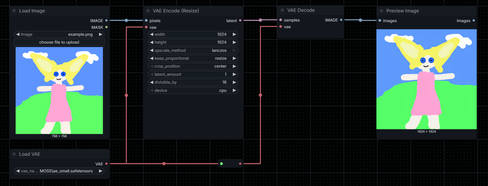

<div align="center">

# ComfyUI VAE Encode Resize
**A compact IMG2IMG utility that combine native VAE Encoding with image sizing.**


</div>

A compact **IMG2IMG** utility for ComfyUI that combines image sizing, native VAE encoding, and native latent batch repetition into one node.

Connect your image and VAE to **VAE Encode (Resize)** and send the `latent` output directly to a sampler.

# Workflow

```text
Load Image / IMAGE ──┐
                     ├── VAE Encode (Resize) ── LATENT ── KSampler
VAE Loader / VAE ────┘
```

**Inputs:** `pixels` (`IMAGE`) and `vae` (`VAE`). 
**Output:** `latent` (`LATENT`). 

# Settings
| Setting | Default | Description |
| --- | --- | --- |
| `width` | `0` | Target width in pixels; `0` means automatic/source-based sizing. |
| `height` | `0` | Target height in pixels; `0` means automatic/source-based sizing. |
| `upscale_method` | `bicubic` | `nearest-exact`, `bilinear`, `area`, `bicubic`, `lanczos`. |
| `keep_proportional` | `stretch` | Controls the relationship between source and target aspect ratios. |
| `crop_position` | `center` | `center`, `top`, `bottom`, `left`, `right`; affects crop and padding placement. |
| `latent_amount` | `1` | Repeats the **already encoded** latent batch, matching native `RepeatLatentBatch`. Max 64. |
| `divisible_by` | `8` | Rounds final pixel dimensions down to a multiple; `0` or `1` disables this. |
| `device` | `cpu` | Runs pixel resizing/padding on CPU or GPU; VAE encoding still uses normal ComfyUI VAE device handling. |

# Aspect ratio options
| Mode | Result |
| --- | --- |
| `stretch` | Scale to the chosen width/height, even if the aspect ratio changes. |
| `resize` | Fit inside the specified dimensions while preserving aspect ratio, **without** a border; output can be smaller than the target canvas. |
| `pad` | Fit with aspect ratio preserved, then fill remaining space with **black**. |
| `pad_edge` | Fit and fill borders using the **mean color** of each image edge. |
| `pad_edge_pixel` | Fit and repeat exact edge pixels across the border. |
| `crop` | Crop to the desired aspect ratio using `crop_position`, then resize. |
| `pillarbox_blur` | Fit and fill the remaining space with a dimmed, blurred copy of the image. |
| `total_pixels` | Treat `width × height` as a total pixel budget, then derive size from the source aspect ratio. |

**Auto dimensions:** `width=0, height=0` preserves source dimensions (subject to `divisible_by`). When `stretch` or `crop` has one dimension set to `0`, that axis keeps its source size. In aspect-preserving modes, a missing dimension is inferred from the source ratio.
**Padding color:** `pad` currently uses solid black, deliberately avoiding an extra widget.
**Lanczos:** ComfyUI's native Lanczos upscaling requires CPU. Select `device=cpu`, or switch to a different interpolation for GPU.
**VAE compatibility:** Models can require a specific pixel-size multiple. For those VAEs, choose a compatible `divisible_by` (often 8, 16 or 32). This control applies to image dimensions *before* encoding; it does not resize latent tensors directly.

# Implementation
- Uses `comfy.utils.common_upscale` for interpolation.
- Uses ComfyUI's own `nodes.VAEEncode` for encoding.
- Uses ComfyUI's own `nodes.RepeatLatentBatch` **after encoding**.
- Implements framing via standard PyTorch tensor operations, without importing KJNodes.
- Preserves incoming image batches; an existing batch of `B` images and `latent_amount=N` produces `B × N` latent items.
- Requires no extra Python packages beyond the dependencies already used by ComfyUI.
- Registers as `VicVAEEncodeResize`, avoiding collisions with native nodes and existing Workflows.

# Sources
- [ComfyUI — native `VAEEncode` and `RepeatLatentBatch` (`nodes.py`)](https://github.com/Comfy-Org/ComfyUI/blob/master/nodes.py)
- [ComfyUI — native image interpolation (`comfy/utils.py`)](https://github.com/Comfy-Org/ComfyUI/blob/master/comfy/utils.py)
- [ComfyUI-KJNodes — `ImageResizeKJv2` / Resize Image v2](https://github.com/kijai/ComfyUI-KJNodes/blob/main/nodes/image_nodes.py)
- [ComfyUI-KJNodes — `ImagePadKJ` reference for border modes](https://github.com/kijai/ComfyUI-KJNodes/blob/main/nodes/image_nodes.py)
- [ComfyUI documentation — Custom Nodes](https://docs.comfy.org/custom-nodes/overview)

The resizing and padding integration in this project is independently written using native ComfyUI/PyTorch primitives. The KJNodes references document the user-facing mode semantics.

# License
See [LICENSE](LICENSE).