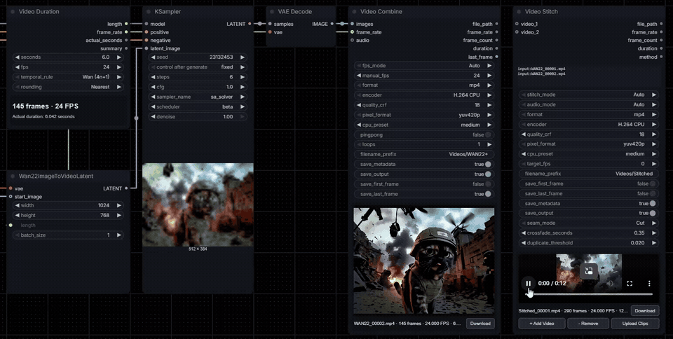

<div align="center">

# ComfyUI Video Tools
**A set of four nodes for planing, saving, exporting and stitching together videos.**

<p align="center">
  
</p>
</div>

A lightweight module with four nodes for **planning video duration**, **loading videos**, **exporting image frames**, and **stitching already-encoded clips with optional seam cleanup and transitions**.

# Nodes
| Node | Function | Inputs / outputs |
| --- | --- | --- |
| **Video Duration** | Choose target seconds and FPS; converts to the nearest valid frame count for Wan (4n+1) or any count | `length` (INT), `frame_rate` (FLOAT), `actual_seconds` (FLOAT), `summary` (STRING) |
| **Video Load** | Upload and decode an input video with optional start/end time, FPS conversion, resize, skip and frame limits | `images`, `mask`, `audio`, `frame_rate`, `frame_count`, `duration`, `video_info` |
| **Video Combine** | Encode IMAGE batches into MP4, MKV, WebM or GIF, and expose the final frame for continuation | `file_path`, `frame_rate`, `frame_count`, `duration`, `last_frame` (IMAGE) |
| **Video Stitch** | Concatenate 2–16 clips, optionally remove duplicate seam frames or crossfade | `file_path`, `frame_rate`, `frame_count`, `duration`, `method` |

# Requirements
FFmpeg **and** FFprobe must be available in the ComfyUI process `PATH`, or set `VICVIDEO_FFMPEG` and `VICVIDEO_FFPROBE` environment variables to their full executable paths. A complete Windows FFmpeg build includes both. Standard ComfyUI dependencies (`torch`, `numpy`, `Pillow`, `aiohttp`) are used. No Python `pip` install or startup-time model probing is required for this module.

Once done, restart ComfyUI and hard-refresh the browser (`Ctrl+F5`).

# How to wire Wan 2.2 5B
```text
Video Duration [seconds=5, fps=24, Wan (4n+1)]
    length ---------------------> Wan22ImageToVideoLatent.length
    frame_rate -----------------> Video Combine.frame_rate
Wan22ImageToVideoLatent -> sampler -> VAE Decode -> Video Combine.images
```

The default **5.0 seconds at 24 FPS** becomes **121 frames** (`4n+1`), which makes a 121/24 = **5.042 second** output. The `length` output is a standard INT compatible with the Wan latent node's `length` input (convert that widget to an input if needed).

To choose a different output FPS, change Video Duration's FPS. To override at export time only, choose `fps_mode = Manual` in Video Combine and set `manual_fps`. Changing **only** export FPS changes playback speed/duration; it does not add or regenerate video frames.

The `fps_mode = Auto` uses the connected `frame_rate` value **when connected**; otherwise, it uses `manual_fps` as a safe fallback. IMAGE batches do not contain frame-rate metadata.

# Video Load
- Press **Upload Video**, or select an already-uploaded video from ComfyUI's input directory.
- `start_time` and `duration` are measured in **seconds**. A duration of `0` means until the file ends.
- `force_fps=0` preserves the source's nominal frame rate; specifying a positive number resamples it (FFmpeg `fps`).
- `force_width=0, force_height=0` preserves source dimensions, rounded to even numbers. Specifying only one dimension maintains the aspect ratio.
- `resize_mode = Fit` fits inside the chosen box while preserving aspect ratio; `Stretch` resizes to the box exactly; `Crop` fills then center-crops to the box.
- `skip_first_frames` is applied **after** FPS conversion; `select_every_nth` keeps every Nth decoded frame. Output `frame_rate` is divided by N so that the remaining frames retain their approximate temporal span.
- `frame_load_cap = 0` means no **explicit** frame cap; however, `max_memory_mb` still imposes a conservative frame limit to avoid exhausting RAM. This cap covers the returned float32 IMAGE batch, **not** the total peak memory of decoder, audio, VAE and sampler.
- AUDIO is decoded from the selected time span when available, otherwise an empty AUDIO waveform is returned. Connecting AUDIO to Video Combine is optional.

**Important:** Long high-resolution clips can use many gigabytes of RAM because ComfyUI's IMAGE batches are float32. Start with a short duration or a frame cap.

# Video Combine
- **Default:** MP4 / H.264 CPU / CRF 18 / yuv420p / 24 FPS.
- Available encoders: H.264 CPU/NVENC, H.265 CPU/NVENC, AV1 NVENC, VP9 CPU, GIF. NVENC requires a supported NVIDIA GPU **and** an FFmpeg build with the corresponding encoder enabled; the node does not silently fall back to CPU.
- Select a compatible **format + encoder** pair. MP4 defaults to H.264; WebM uses VP9; GIF uses GIF; MKV supports the video encoders listed (subject to FFmpeg build support).
- **Quality:** CRF/CQ is lower = better quality/larger files. NVENC CQ is not identical to CPU CRF. `cpu_preset` affects only CPU H.264/H.265.
- `pingpong=true` extends one pass from start to end and back without repeating the endpoints. `loops` repeats the resulting sequence.
- Connect `audio` from Video Load or another AUDIO source to mux sound. Empty audio is omitted; nonempty audio is padded/truncated to final video duration.
- `filename_prefix` accepts subfolders, e.g. `Videos/VicVideo` creates `ComfyUI/output/Videos/VicVideo_00001.mp4` (then `_00002`, etc.). Both `/` and `\` are accepted as separators, and parent-directory escapes are blocked. The generated filename retains the prefix; unrelated random IDs are no longer appended.
- `save_first_frame=true` saves `VicVideo_00001.png` (the first input frame), using the same base filename and output directory as the video. The PNG contains regular ComfyUI `prompt` and `workflow` metadata when `save_metadata=true`, compatible with ComfyUI's image workflow format.
- `save_last_frame=true` saves `VicVideo_00001_last.png` from the **last frame of the actual exported sequence**. This is ideal for Wan image-to-video continuation. The `last_frame` **IMAGE** output is always available for direct connection to a new Wan latent node, even when PNG saving is disabled. The output is RGB [1,H,W,3]. When pingpong is enabled, the last frame follows the reverse playback sequence rather than the final forward input image.
- `save_metadata=true` embeds the available ComfyUI `prompt` and `workflow` metadata in the saved first/last PNG snapshots. Drop one of those PNGs onto the ComfyUI canvas to recover its workflow when the frontend provides that metadata. `save_metadata=false` keeps the snapshots but omits their embedded Workflow metadata. If both PNG saves are disabled, there is no PNG artifact to hold Workflow metadata.
- `save_output=false` writes a temporary video into ComfyUI's temporary directory.
- Output `file_path` is a STRING, and `frame_count`/`duration` reflect the **final** video, including pingpong and loops. Connect `file_path` directly to **Video Stitch.video_1** / **video_2**.

# Video Stitch (no IMAGE batch required)
**The recommended route for stitching Wan 2.2 continuations:** generate each clip with its own Video Combine, take `last_frame` from the first Combine (or use its `_last.png` file) as the reference image for the next Wan clip, and connect both Combine **file_path** outputs to **Video Stitch**. The Stitch node never decodes clips into a ComfyUI IMAGE batch.

```text
Wan clip 1 -> VAE Decode -> Video Combine 1  ---- file_path ----> Video Stitch.video_1
                                | last_frame (IMAGE)
                                v
                             Wan clip 2 -> VAE Decode -> Video Combine 2  ---- file_path ----> Video Stitch.video_2

Video Stitch -> MP4 + first PNG + last PNG (embedded workflow metadata)
```

- **Inputs:** `video_1` and `video_2` are optional STRING sockets for `file_path`. Click **+ Add Video** to add sockets `video_3` through `video_16`, or **- Remove** to remove the last unused socket. Connected sockets cannot be removed accidentally. The socket count persists with the workflow.
- **Upload Clips:** select multiple local videos. They upload into ComfyUI `input/` and are appended as `input:clip.mp4` lines to the `manual_files` widget. You can also type one file path per line in `manual_files`. Connected clips are stitched in numeric port order, followed by the manually listed files in their line order.
- **Manual files:** supported values include `input:clip.mp4`, `output:Videos/VicVideo_00001.mp4`, output-relative `Videos/VicVideo_00001.mp4`, or absolute `file_path` returned by Video Combine. Media must be within ComfyUI's `input`, `output`, or `temp` directories. No arbitrary filesystem reads are allowed.
- **Stitch mode — Auto (recommended):** check compatible video/audio streams and attempt **Copy** with FFmpeg concat demuxer; if this is impossible or fails, re-encode using the selected codec/settings. **Copy** forces stream copy and gives a descriptive error if streams differ. **Re-encode** always normalizes clips to the first clip's dimensions and the chosen FPS.
- **Audio mode:** **Auto** retains audio where available. Re-encode fills missing clips' audio with silence and normalizes to stereo 48 kHz; **Mute** exports video without sound.
- **Target FPS:** `0` keeps the first clip's FPS. Changing FPS forces re-encode. The re-encode path normalizes to a constant output frame cadence and preserves aspect ratio with padding where needed.
- **Output:** MP4 / MKV / WebM, numbered subfolder-aware filename, browser preview, dedicated Download, first and last PNG with optional embedded workflow metadata. `method` reports **Copy** or **Re-encode**. With Copy, codec-related quality settings have no effect because pixels are not re-encoded.
- **Seam mode — Cut (default):** hard-cut join, preserving the v0.2.0 behavior. With matching streams, this remains a fast, lossless stream copy.
- **Seam mode — Remove Duplicate:** inspect the actual decoded **last frame of each clip** and **first frame of the next clip**. Uses a small grayscale comparison to tolerate minor compression differences. If a boundary matches, remove **one first frame from the following clip**, including the equivalent audio time when present. Every seam is checked independently (2–16 inputs). If no frames match, **Auto can still use Copy**; if any frame is removed, FFmpeg must re-encode. The detected scores and decisions are printed in the ComfyUI console.
- **Duplicate threshold (default `0.02`):** normalized average pixel difference from 0 to 1 (the widget accepts 0–0.15). Lower values are stricter; higher values risk discarding a frame with real movement. **Try 0.02 first**, then cautiously raise it if Wan's first reference frame differs slightly from the previous video's last frame. Detection is approximate, not semantic motion detection.
- **Seam mode — Crossfade:** blend the outgoing and incoming frames with FFmpeg's `xfade=fade`; when `audio_mode=Auto`, blend audio with `acrossfade`. Uses `crossfade_seconds` (default `0.35`) **at every junction**. For example, two 121-frame clips at 24 FPS and a 0.35-second transition use eight overlapping frames, giving approximately 9.75 seconds instead of 10.08 seconds. The overlap cannot be longer than the available content.
- **How modes interact:** Crossfade **always re-encodes**, even with identical streams. `stitch_mode=Copy` therefore produces a descriptive error for Crossfade, or for Remove Duplicate when a match requires frame removal. Use `stitch_mode=Auto` (recommended) with either advanced seam mode. Normalizing FPS and resolution happens automatically when needed. Crossfade does not perform optical-flow interpolation or invent genuinely new motion.
- **Existing workflows:** the new parameters are **appended after** the old Video Stitch widgets, so existing saved settings and node connection identifiers remain aligned. Defaults are `seam_mode=Cut`, `crossfade_seconds=0.35`, and `duplicate_threshold=0.02`.
- **No media deletion:** source clips stay untouched. A new video is written every time with an incremented filename, and all temporary concat instructions are deleted on completion.

# Current limitations
This independent VicNodes release is not a complete reimplementation of every VHS feature:
- Remove Duplicate examines just **one boundary frame from each side** and removes **at most one** repeated first frame at each junction. It cannot find long repeated sequences, reconstruct missing frames, or guarantee detection if Wan changes the image substantially.
- Crossfade uses an ordinary dissolve, not optical-flow interpolation or a timeline editor. Crossfades can create ghosting between moving subjects; Cut or Remove Duplicate may suit Wan continuation better.
- Stream copy requires matching codec/time base/stream structure. Some valid-looking files require recoding because their containers have incompatible codec headers.
- No VHS Meta Batch manager interoperability, latent-streamed VAE loading/encoding, asynchronous/chunked ComfyUI frame output, or full animated-preview options yet.
- VIDEO Load returns opaque zero masks; alpha transparency and external URL/path import are not supported.
- No audio waveform time-stretch for manual FPS speed changes; video and audio are muxed at their existing timing. Auto FPS wiring is recommended to preserve synchronization.
- No support yet for arbitrary VHS custom format JSONs, lossless 16-bit processing, or video-embedded workflow metadata.
- Video previews use browser-supported playback codecs. A video with H.265, AV1 or MKV output may encode correctly but **not preview** in some browsers; MP4 H.264 is the compatibility default.
- `Video Load` is deliberately bounded by `max_memory_mb` and may stop before the end when no frame limit is supplied; the node prints this in its info output.
- Decoder output uses RGB float32 IMAGE; input video audio is always resampled to stereo 44.1 kHz when present.
- Preview and upload routes require the ComfyUI server environment; no separate web application is installed.

# Sources
- **[ComfyUI-VideoHelperSuite](https://github.com/Kosinkadink/ComfyUI-VideoHelperSuite)** — Reference for video loading, combining, frame handling, output formats, and preview functionality.
- **[Wan 2.2](https://github.com/Wan-Video/Wan2.2)** — Official model documentation, including video generation, frame rates, and temporal specifications.
- **[FFmpeg Documentation](https://ffmpeg.org/ffmpeg.html)** — Video encoding, decoding, format conversion, and audio processing.
- **[FFmpeg Concat Demuxer](https://ffmpeg.org/ffmpeg-formats.html#concat-1)** — Concatenating compatible video files without re-encoding.
- **[FFmpeg Filters](https://ffmpeg.org/ffmpeg-filters.html)** — Video and audio transitions, including `xfade`, `acrossfade`, and frame processing.
- **[FFprobe Documentation](https://ffmpeg.org/ffprobe.html)** — Reading video metadata, codecs, resolution, frame rates, and stream information.
- **[ComfyUI Custom Nodes](https://docs.comfy.org/custom-nodes/walkthrough)** — Node architecture, registration, inputs, outputs, and backend integration.
- **[ComfyUI JavaScript Extensions](https://docs.comfy.org/custom-nodes/js/javascript_overview)** — Custom frontend widgets, previews, and UI integration.
- **[ComfyUI JavaScript Hooks](https://docs.comfy.org/custom-nodes/js/javascript_hooks)** — Node lifecycle, frontend events, and workflow restoration.

Video Tools is an independently developed implementation, with its own functionality and interface, built using these projects and documentation as technical references.

Special thanks to **[Kosinkadink](https://github.com/Kosinkadink)**, creator of **[ComfyUI-VideoHelperSuite](https://github.com/Kosinkadink/ComfyUI-VideoHelperSuite)**.

# License
See [LICENSE](LICENSE).