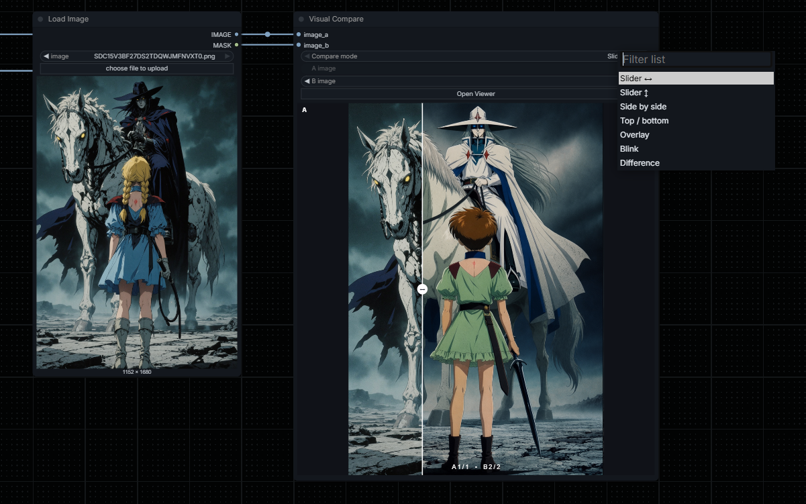

<div align="center">

# ComfyUI Visual Compare
**Image comparator with various functions and features.**


</div>

**Visual Compare** is a lightweight, interactive A/B image inspector for the **classic ComfyUI LiteGraph node interface (not Nodes 2.0)**.

Designed for comparing image generations, samplers, upscalers, LoRA outputs, and before/after refinement.

## Latest release
### 1.0
Added
- Initial commit

# Installation

### Git
Open a terminal inside the ComfyUI `custom_nodes` directory and clone the repository:

```bash
cd ComfyUI/custom_nodes
git clone https://github.com/VictorDmAlves/comfyui-visual-compare.git
```

### ZIP
1. Download the repository as a ZIP file.
2. Extract it into `ComfyUI/custom_nodes/`.
3. Make sure the final structure is not nested twice.

Restart ComfyUI and add **Visual Compare** from `extensions/VicNodes/Visual Compare`.

## Features
| Feature | How it works |
| --- | --- |
| 7 comparison modes | Slider ↔, Slider ↕, Side by side, Top/bottom grid, Overlay, Blink, Difference heatmap |
| Smart Magnifier | Two side-by-side synchronized lenses (2× / 4× / 8×), following the same image coordinates |
| Difference Inspector | Adjustable pixel-difference heatmap, with click-to-focus inside Difference mode |
| Region Focus | Drag-select a rectangle, compare that same region on both images, and enlarge it in the viewer |
| Export Comparison | PNG export of **current pair or batch contact sheet**, each comparison labeled, with optional differences and region close-ups; up to 12 pairs per page |
| Responsive preview | Image canvas expands with the **node's actual dimensions**; it is no longer fixed at 308px high |
| Blink in the node | Animated A/B comparison runs in both the compact node and enlarged viewer |
| Batch A/B selection | Each `IMAGE` input can contain 1–64 frames; switch selected frames with the A/B selectors in the node or Viewer without requeueing |
| Batch navigation | **Auto / Manual / Sync / Fixed A / Fixed B** (Selection policy in the Viewer only) with explicit live explanations, manual Step A/B choice and prev/next buttons |
| Contextual tips | Viewer footer explains the actively selected tool (Compare, Selection, Fit, magnifier, region, etc.) and why a batch mode does or does not advance |
| Compact node | A/B preview directly in the node; advanced tools in a larger viewer |
| No extra dependencies | Python only uses NumPy and Pillow, already provided by ComfyUI. No additional frontend packages |

### Interface
- Two required inputs: `image_a`, `image_b` (`IMAGE`), supporting **independent batches of up to 64 images per input**.
- Output-only node, **no output sockets**. It does **not** modify the image tensors or overwrite originals.
- Use the **Compare mode** dropdown (native ComfyUI combo) to select all seven modes.
- Use **A image** and **B image** to choose which frames to compare. The advanced **Selection** policy (Auto / Manual / Sync / Fixed A / Fixed B) is configured **only inside the Viewer**. Index labels are **1-based**, e.g. `2 / 3` indicates the second of three frames.
- **Auto** resolves to Fixed A for 1×many, Fixed B for many×1, Sync for equal multi-image batch counts, and Manual otherwise. The Viewer displays the resolved mode (`Auto → Fixed A`, etc.) with an explanatory footer.
- With **Sync**, choosing an A/B index changes both indices to the same frame number, clamped to the shorter batch length. Prev/Next also advances both sides together. For **1×many**, Sync has only one paired comparison and intentionally disables Prev/Next; use Fixed A instead.
- **Fixed A** holds A steady while Prev/Next advances B; **Fixed B** holds B steady while advancing A. You may still manually select a different reference on the fixed side.
- **Manual** allows independent A/B selectors. A **Step** selector appears to choose whether Prev/Next advances **A** or **B**. If the chosen side contains only one image, Prev/Next disables rather than silently moving another side.
- Click the **Open Viewer** button (native ComfyUI widget) to use the full inspector.
- In Slider mode, drag the divider right on the compact preview. Resize the node freely: the preview fills the remaining height and width without stretching source pixels.
- The viewer offers **Fit: Contain / Cover / Stretch**. `Contain` is the default, so source images with different aspect ratios are not distorted.
- All UI settings (including selected region) are saved in the workflow as node properties. Image previews themselves are temporary and require queueing the node after reopening ComfyUI.

## How to use the comparison tools
1. **Comparison modes:** Select Slider (horizontal/vertical movement), Side by side, Top/bottom, Overlay (adjust opacity), Blink (alternates A/B ~550ms **in node and viewer**), or Difference.
2. **Magnifier:** Enable **Smart magnifier**, choose 2×, 4× or 8×, then hover anywhere over the images. Both lenses inspect matching image coordinates.
3. **Difference Inspector:** Choose **Difference heatmap** and adjust sensitivity. Click a region in the heatmap to focus on that area; click **Focus region** to return.
4. **Region Focus:** Click **Select region**, drag a rectangle, then click **Focus region**. Click again to return to the full image. **Clear region** removes the selection.
5. **Export:** Click **Export PNG** and choose the export scope, editable A/B labels, optional heatmap/region close-ups, and click **Save PNG**. The browser downloads a composed image; it does not write to ComfyUI's output folder.

### Batch export
The export dialog supports these scopes:
| Export images | Result |
| --- | --- |
| **Auto (based on Selection)** | Fixed A → every B vs selected A; Fixed B → every A vs selected B; Sync → matched pairs; Manual → current pair |
| **Current A/B pair only** | One row with the current selection |
| **Every B vs selected A** | A remains the reference, and each B creates a new row |
| **Every A vs selected B** | B remains the reference, and each A creates a new row |
| **Matching pairs** | Rows A1/B1, A2/B2, up to the size of the shorter batch |

Each row has two original panels (A/B) and optionally a third difference heatmap panel. The exported sheet includes the selected indices, user-editable labels, optional highlighted region and matching region close-ups.

A sheet holds **at most 12 pair comparisons**; a **Sheet page** selector appears for larger sets, so each page can be exported as an individual PNG. For example, a 1×25 batch creates three pages (12 + 12 + 1). PNGs are scaled down only when needed to respect practical browser canvas memory/dimension limits.

No new dependencies, and no requeue required to export a different pair/page.

## Practical notes / limitations
- **Batch frame limit:** up to **64 images per input** are written as temporary PNG previews when the node executes. The browser lazily loads only the selected pair and keeps a small image cache. Larger batches produce a clear validation error instead of silently discarding images.
- **Batch selection is frontend-only:** switching A/B frames does not re-run sampling, but the input IMAGE batches must be passed to the node and queued once. The two inputs can have different batch lengths and resolutions.
- **Viewport fitting:** the compact preview uses contain/fit to preserve aspect ratio and may display bars when the node and input ratio differ. The viewer offers Contain/Cover/Stretch options. The comparison canvas itself grows/shrinks with the LiteGraph node.
- **Blink runs only while selected:** switching away from Blink stops its timer; removing the node clears its interval.
- **Difference = pixel difference:** heatmap compares absolute RGB values, not semantic/object differences. It will highlight camera movement, lighting, or alignment changes even if the objects are similar.
- **Resolution mismatch:** A defines the reference coordinate system. B is fitted to the same canvas; `contain` preserves proportions with background bars. Pixel comparisons are most meaningful for images that share composition and dimensions.
- **Heatmap resolution:** the difference layer is calculated in the browser at a maximum preview size of 1600 px (longest side). Source A/B are kept at original resolution for the PNG export where canvas limits permit.
- **Large exports:** sheets are limited to 12 comparisons per page and may downscale extremely large composite images to respect browser canvas dimensions and memory. The export dialog reports final dimensions after saving. The user selects a page explicitly; it does not automatically trigger many downloads.
- **Temporary previews:** ComfyUI's temp directory is used to expose the images to the web viewer. The previews do not automatically create output files. Requeue the workflow to restore previews after a restart/reload.
- **RGBA support:** RGBA frames are accepted, though the difference analysis is calculated on RGB channels.
- **Performance:** heavy inference/GPU operations are not used for the viewer. The first render and heatmap computation can still take some CPU/RAM for large images; both are cached until inputs or settings change.

## License
See [LICENSE](LICENSE).